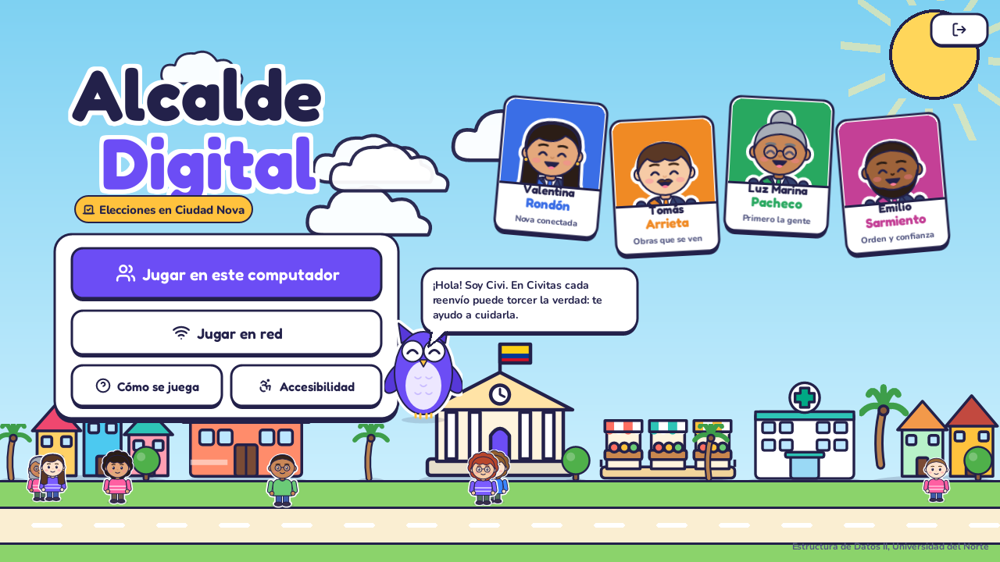
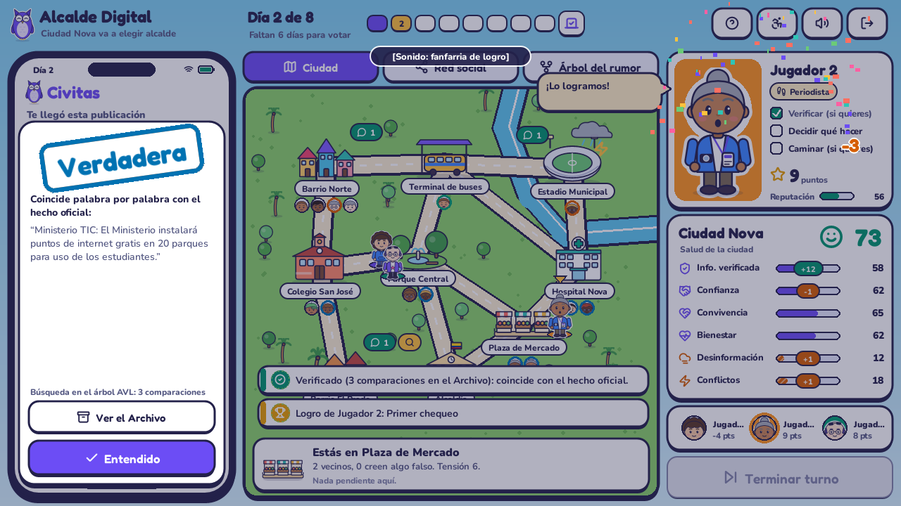
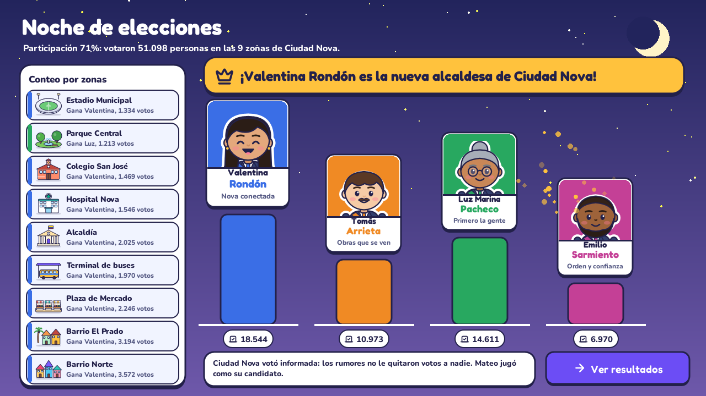

# Alcalde Digital

Videojuego educativo sobre el uso responsable de las redes sociales.
Estructura de Datos II, Universidad del Norte.



Ciudad Nova elige alcalde y todos hablan en **Civitas**, su red social. Ahí circulan noticias verdaderas, opiniones y rumores, y cada reenvío puede torcer la historia: inflar una cifra, quitar el contexto, inventar la fuente o echarle la culpa a un candidato. De 2 a 4 jugadores (ciudadano, periodista, influencer y candidato) deciden qué hacer con cada publicación, recorren la ciudad conversando con los vecinos y ven cómo sus decisiones cambian la ciudad y el resultado de la elección.

No hay preguntas de trivia: se aprende verificando antes de compartir, descubriendo dónde se torció una historia y viendo las consecuencias.

**Cómo es un turno:** cada jugador tiene **12 minutos** y atiende **hasta 2 publicaciones**. Te llega una publicación de la zona del mapa donde estás; si prefieres otra, caminas a otra zona y te llega una de allí (los globitos del mapa dicen cuántas circulan en cada zona). **Caminar cuesta los minutos de la calle** (el mapa muestra el costo de cada zona), verificar y decidir cuestan 2 minutos cada una y conversar cuesta 3, así que no alcanza para todo: hay que elegir. Puedes verificarla (cuesta además 3 puntos) y luego decides qué hacer: compartirla, reportarla, ignorarla o usar el poder de tu personaje. Al decidir, todos ven si era verdadera o falsa, así que conviene acordarse: quien recuerda lo que ya se descubrió se ahorra las verificaciones y saca más puntos. Lo que decides se nota en la zona donde circula la publicación: si frenas un rumor, sus vecinos dejan de creerlo; si lo compartes, la zona se agita. **Estar en esa zona importa:** frenar un rumor desde lejos rinde solo la mitad.

**Reloj y pausa (en el mismo computador):** al empezar eliges cuánto tiempo tiene cada jugador para decidir sobre cada publicación (20 s por defecto, o sin límite). Si el reloj llega a cero, el turno pasa solo al siguiente jugador. También eliges si hay **pausa entre días**: con pausa, al llegar la noche todo se detiene hasta pulsar «Iniciar día» (útil para explicar con calma); sin pausa, la partida sigue de corrido. Con la tecla `P` o el botón «Pausa» se detiene el reloj en cualquier momento.

| | |
|---|---|
|  |  |
|  |  |

## Las estructuras de datos

| Estructura | Archivo | Para qué la usa el juego |
|---|---|---|
| **Árbol de mutaciones** (n-ario con puntero al padre) | `alcalde/estructuras/arbol_mutaciones.py` | La genealogía de cada historia. Rastrear el origen, podar una rama al reportar, encontrar dónde mutó |
| **Archivo de hechos** (árbol AVL) | `alcalde/estructuras/archivo_avl.py` | Verificar es buscar el hecho oficial; el periodista inserta los hechos que faltan |
| **Red social** (grafo dirigido y ponderado) | `alcalde/estructuras/grafo.py`, `alcalde/modelo/red_social.py` | Quién sigue a quién y cuánto confía. Cada noche, la publicación avanza un nivel de BFS y ese recorrido **es** el árbol de mutaciones |
| **Mapa de la ciudad** (grafo no dirigido y ponderado) | `alcalde/estructuras/grafo.py`, `alcalde/modelo/mapa.py` | Moverse por la ruta más corta (Dijkstra), verificar en persona, contagio de conflictos entre zonas y votación por zonas |

Justificación detallada: [Entrega 1, árboles](docs/ENTREGA_1.md) · [Entrega 2, grafos](docs/ENTREGA_2.md) · [Entrega final, producto integrado](docs/ENTREGA_FINAL.md).

## Cómo ejecutar

Se necesita **Python 3.10 o superior** ([python.org](https://www.python.org/downloads/); en Windows, marcar «Add Python to PATH» al instalar).

**1. Obtener el proyecto.** Con `git clone https://github.com/charlie1728/Laboratorio-1-alcalde-digital.git`, o descargando el ZIP desde GitHub (**Code › Download ZIP**) y **extrayéndolo por completo** con «Extraer todo» antes de abrir una terminal ahí.

**2. Abrir una terminal en la carpeta del proyecto** (la que tiene `main.py`). En Windows: clic en la barra de direcciones del Explorador, escribir `cmd` y Enter.

**3. Instalar la única dependencia (Pygame) y jugar:**

```bash
pip install -r requirements.txt
python main.py
```

Con `python main.py 42` la partida es siempre la misma (útil para revisar o sustentar).

En Windows también se puede abrir con **doble clic en `jugar.bat`**. El juego abre en una ventana maximizada; con `F11` pasa a pantalla completa.

### Jugar en red

Cada jugador en su computador, conectados a la misma red wifi:

1. Uno elige **Jugar en red › Crear partida**. Su pantalla muestra la dirección (por ejemplo `192.168.1.20`).
2. Los demás eligen **Jugar en red**, escriben esa dirección y pulsan **Unirse**.
3. El anfitrión pulsa **Comenzar partida**.

Para probar en un solo computador, abre el juego dos veces y deja la dirección vacía (se conecta a `127.0.0.1`). También hay un servidor dedicado sin ventana:

```bash
python servidor.py --puerto 5050
```

Si Windows pregunta por el firewall, hay que permitir el acceso en redes privadas.

### Pruebas automáticas

```bash
python -m unittest discover -s tests -v
```

Son 46 pruebas: árboles, grafos, su integración, el presupuesto de minutos del turno y una partida completa en red con sockets reales.

## Controles

| Acción | Cómo |
|---|---|
| Verificar la publicación del turno | Botón del celular o tecla `1` (3 puntos y 2 minutos) |
| Decidir: compartir, reportar, ignorar o especial | Botones del celular o teclas `2` a `5` (2 minutos) |
| Pasar a la segunda publicación del turno | Botón «Siguiente publicación» o tecla `N` |
| Caminar por la ciudad | Clic en una zona del mapa (cuesta los minutos de la ruta más corta) |
| Pausar la partida | Botón «Pausa» o tecla `P` |
| Conversar con los vecinos | Botón «Conversar» en la tarjeta de tu zona |
| Cambiar de vista (ciudad, red, árbol) | Pestañas o `Tab` |
| Terminar el turno | Botón o `Enter` |
| Archivo AVL | Botón «Archivo» en el árbol, o tecla `A` |
| Ayuda, alto contraste, sonido | `H`, `C`, `M` |

## Estructura del proyecto

```
main.py                   # el juego
servidor.py               # servidor dedicado (opcional)
alcalde/
  estructuras/            # árbol de mutaciones, AVL y grafo: no dependen del juego
  modelo/                 # lógica sin interfaz: partida, red social, mapa, elección, serialización
  red/                    # protocolo, servidor y cliente (sockets TCP)
  controlador.py          # la interfaz pide jugadas a un controlador local o en red
  ui/                     # interfaz en Pygame: pantallas, vistas, personajes, edificios, sonido
assets/                   # fuentes (OFL), iconos (Lucide, ISC) y sonidos generados
tools/generar_audio.py    # sintetiza los efectos y la música
tests/                    # pruebas de árboles, grafos y red
docs/                     # justificación de cada entrega y capturas
```

## Estado por entregas

- [x] **Entrega 1:** árbol de mutaciones y árbol AVL con sus operaciones y recorridos, integrados a la mecánica, con interfaz gráfica preliminar.
- [x] **Entrega 2:** grafo social y grafo de la ciudad con BFS, DFS, componentes conexas, Dijkstra, camino de máxima confianza y grados. La propagación por la red construye el árbol de mutaciones, y los grafos se ven en pantalla con animaciones y herramientas para demostrar cada operación.
- [x] **Entrega final:** elección del alcalde por zonas, multijugador cliente-servidor con sockets, rediseño visual con personajes ilustrados, accesibilidad, ayuda y guía, sonidos y música, y pruebas de estabilidad.
