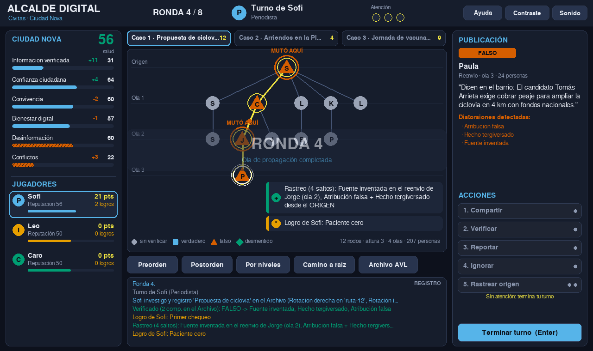

# Alcalde Digital: el árbol de mutaciones

Videojuego educativo sobre el uso responsable de las redes sociales.
Estructura de Datos II, Universidad del Norte. **Primera entrega (semana 8): árboles e interfaz gráfica preliminar.**



## La idea

En Ciudad Nova, en plena campaña para alcalde, las publicaciones de la red social **Civitas** casi nunca se reenvían tal cual: con cada reenvío alguien **infla una cifra, borra el contexto, cambia la fuente, tuerce el hecho o se lo atribuye a un candidato**. El juego representa cada historia como un **árbol de mutaciones**:

- la **raíz** es la publicación original (el "paciente cero"),
- cada **hijo** es un reenvío hecho a partir de su padre,
- cada **arista** puede traer una distorsión nueva.

Los jugadores no responden preguntas de conocimiento. Aprenden jugando: mirando cómo crece el árbol en cada ola de propagación, buscando **en qué reenvío exacto se torció la verdad** y decidiendo si comparten, verifican, reportan (se cae la rama completa) o ignoran.

## Cómo ejecutar

Se necesita **Python 3.10 o superior** ([python.org](https://www.python.org/downloads/); en Windows, marcar "Add Python to PATH" durante la instalación).

**1. Obtener el proyecto.** Dos formas:

- `git clone https://github.com/charlie1728/Laboratorio-1-alcalde-digital.git` (recomendado), o
- descargar el ZIP desde GitHub (botón verde **Code → Download ZIP**) y **extraerlo por completo** con "Extraer todo" antes de abrir una terminal ahí. ⚠️ Si abres una terminal mientras el Explorador de Windows solo está *previsualizando* el ZIP (sigue apareciendo el botón "Extraer todo"), los comandos van a fallar porque no es una carpeta real todavía.

**2. Abrir una terminal dentro de la carpeta del proyecto** (la que contiene `main.py`). En Windows: clic en un espacio vacío de esa carpeta en el Explorador, borrar la ruta de la barra de direcciones, escribir `cmd` y Enter.

**3. Instalar la dependencia (solo Pygame) y ejecutar:**

```bash
pip install -r requirements.txt
python main.py            # partida aleatoria
python main.py 42         # partida con semilla fija (reproducible, útil para revisar/sustentar)
```

Se abre una ventana de 1280×760 con el juego. Con `python main.py 42` la partida es idéntica cada vez que se ejecuta.

**Pruebas automáticas de las estructuras (opcional, no abren ventana):**

```bash
python -m unittest discover -s tests -v
```

## Controles

| Acción | Cómo |
|---|---|
| Seleccionar publicación | clic en un nodo (pasa el mouse encima para leerla) |
| Acciones | botones del panel derecho, o las teclas `1`–`6` |
| Terminar turno | botón o `Enter` |
| Cambiar de caso | pestañas o `Tab` |
| Recorridos / Archivo AVL | barra bajo el árbol |
| Ayuda / Alto contraste / Sonido | `H` / `C` / `M` |

## Estructura del proyecto

```
alcalde/
  estructuras/
    arbol_mutaciones.py   # árbol general n-ario: genealogía de un rumor
    archivo_avl.py        # árbol AVL: archivo de hechos oficiales
  modelo/                 # lógica del juego (sin interfaz, se puede probar sola)
    afirmacion.py         # contenido de una publicación y sus distorsiones
    hechos.py             # hechos reales de Ciudad Nova y candidatos
    roles.py              # Ciudadano, Periodista, Influencer, Candidato
    ciudad.py             # indicadores de la ciudad
    partida.py            # turnos, acciones, olas de propagación, eventos
  ui/                     # interfaz gráfica en Pygame
tests/test_arboles.py     # pruebas unitarias
docs/ENTREGA_1.md         # justificación de los árboles (lo que se evalúa)
```

## Estado por entregas

- [x] **Entrega 1:** árbol de mutaciones y árbol AVL con sus operaciones y recorridos, integrados a la mecánica. Interfaz gráfica preliminar jugable por turnos (2 a 4 jugadores locales), con roles, eventos aleatorios, evento viral con tiempo límite, ayuda, alto contraste y sonidos.
- [ ] **Entrega 2:** grafo social y grafo de la ciudad. El autor de cada reenvío y la probabilidad de que ocurra saldrán del grafo social, en lugar del azar que se usa hoy.
- [ ] **Entrega final:** elección del alcalde, multijugador cliente-servidor con sockets y pulido general.
