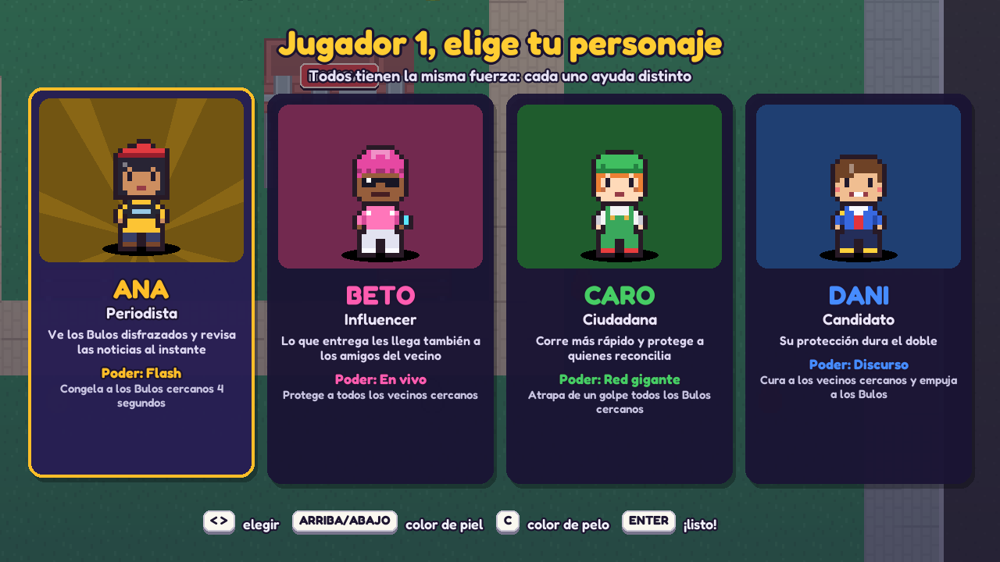

# Cazabulos · Alcalde Digital

Videojuego educativo sobre el uso responsable de las redes sociales.
Estructura de Datos II, Universidad del Norte.

Ciudad Nova va a elegir alcalde y por la red social Civitas corren los **Bulos**: rumores falsos que se suben a la cabeza de los vecinos y los vuelven **morados**. Un vecino morado, si nadie lo cura, le pasa el Bulo a un amigo por la red social. Tú caminas por el barrio, atrapas los Bulos, curas a los morados y compartes las noticias verdaderas (las estrellas).

**En una frase: salva a la mayor cantidad de vecinos.**


## Cómo se juega

Antes de cada turno, la cuenta regresiva explica el juego en tres dibujos: **atrapa los Bulos, cura a los morados y recoge las estrellas**. Durante el juego casi no hay textos encima: solo una o dos palabras arriba cuando pasa algo importante (¡PELEA!, ¡CADENA DE 3!) y flechas con dibujos hacia lo que no se ve.

| Tecla | Qué hace |
|---|---|
| **Flechas** (o WASD) | Caminar por el barrio |
| **Espacio** (se puede mantener) | Lanzar tu herramienta. Todo se arregla lanzándole: los Bulos, los vecinos morados, la antena, las peleas y el Bulo viral |
| **X** | El poder de tu personaje, cuando el círculo se llena |
| **Esc** | Pausa · **M** silencia la música · **F11** cambia entre ventana grande y pantalla completa |

**Con control USB** (tipo Xbox): cruceta o palanca para caminar, **A** para lanzar o aceptar, **B** o **X** para el poder (en los menús B es volver), **Start** para pausa. Las ayudas en pantalla cambian solas a los botones del control.

- **Bulos:** salen de la antena del Bot y vuelan hacia los vecinos con más amigos. Si llegan, se le suben a la cabeza y el vecino se pone morado.
- **Vecinos morados:** después de un rato le pasan el Bulo a un amigo por su hilo de la red social. En los últimos segundos aparece una línea punteada hacia el amigo que lo va a recibir: es el momento de curarlo. El Bulo que viaja por el hilo también se puede cortar en el aire.
- **Bulo con corona:** es la raíz de una cadena. Si lo atrapas, caen todas sus copias de una vez.
- **Estrellas (noticias verdaderas):** con solo tocarlas se comparten: la verdad le llega al vecino más cercano y a sus amigos, los cura y los protege un rato (brillan dorado).
- **Antena del Bot:** suelta Bulos sin parar. Golpéala varias veces para apagarla (después pone otra en otro lugar).
- **Eventos al azar:** peleas entre vecinos (si no las calmas a tiempo se rompe la amistad), el **Bulo viral** con 10 segundos para detenerlo, rumores sobre los candidatos, noticias verdaderas, campañas de convivencia, grupos de Bulos nuevos y vecinos que reportan por su cuenta.

## Personajes (fuerza pareja, cada uno ayuda distinto)



| Personaje | Rol | Lanza | Ventaja | Poder (X) |
|---|---|---|---|---|
| **Ana** (amarillo) | Periodista | periódicos | Ve todos los Bulos en el mapa y su periódico atraviesa varios | **Flash:** congela a todos los Bulos de la pantalla |
| **Beto** (rosa) | Influencer | corazones | Cuando cura a alguien, la cura les llega también a sus amigos. Sus estrellas llegan dos niveles en la red | **En vivo:** protege a todos los vecinos de la pantalla |
| **Caro** (verde) | Ciudadana | su red | Corre más rápido, su red es más ancha y calma una pelea de un golpe | **Red gigante:** atrapa de un golpe todos los Bulos cercanos |
| **Dani** (azul) | Candidato | volantes | A quien cura no le vuelven a entrar Bulos por un buen rato. Compite en la elección | **Discurso:** cura a los vecinos cercanos y empuja a los Bulos |

La piel y el color de pelo se pueden cambiar al elegir. Con jugadores automáticos (20 partidas por personaje) los cuatro sacan puntajes parecidos.

## Modos

- **¡Jugar ya!:** un turno de 90 segundos en modo tranquilo, sin configurar nada. Ideal para la fila de la feria.
- **Mismo computador (1 a 4):** no se comparte el teclado. Cada uno juega su turno (90 segundos, 2 o 3 minutos) y le pasa el teclado al siguiente. En cada ronda todos juegan **el mismo barrio con los mismos eventos** (misma semilla), así es justo. Hasta 3 rondas: mañana, tarde y noche.
- **En línea (2 a 4 computadores en la misma red):** uno crea la sala y los demás escriben la dirección que aparece. Todos juegan a la vez, ven a los rivales como fantasmas y el marcador en vivo.

Al final viene la **elección del alcalde**: si la desinformación promedio quedó por debajo de 50 gana un candidato con propuestas; si llegó a 50 (la mitad del barrio se creyó los Bulos) gana Emilio Bot. Luego el podio con el ganador de la partida.

**Para la feria:** el juego abre en una ventana grande que llena la pantalla (F11 la pasa a pantalla completa y la devuelve). Cerca de las orillas del mapa la cámara se corre para que los paneles no tapen al jugador, y si algo importante queda debajo de un panel, el panel se vuelve casi transparente. Si nadie toca nada durante 90 segundos vuelve solo a la pantalla de inicio (no pasa a mitad de un turno ni en el modo en línea). Si una pantalla falla, el error se guarda en `cazabulos_error.log` y el juego vuelve al inicio en vez de cerrarse. "Salir" pregunta antes de cerrar, por si un niño lo toca sin querer.

## Las estructuras de datos y para qué sirven

| Estructura | Archivo | Problema que resuelve en el juego |
|---|---|---|
| Grafo social (lista de adyacencia, peso = confianza) | `cazabulos/estructuras/grafo.py`, `cazabulos/ciudad.py` | Por los hilos viajan los Bulos: cada morado se lo pasa al amigo en quien más confía (mayor peso). La verdad de las estrellas y el viral se riegan con **BFS** (quién la recibe, cuántos y en qué orden). Las peleas **eliminan aristas** y las campañas **agregan aristas**. Los Bulos buscan al vecino de mayor **grado**. |
| Grafo de la ciudad (lugares y esquinas, peso = distancia) | `cazabulos/mapa.py`, `cazabulos/ciudad.py` | **Dijkstra** da la ruta más corta: la línea que guía al jugador hacia lo más urgente y el camino de los vecinos entre zonas sin atravesar edificios. |
| Árbol n-ario de mutaciones | `cazabulos/estructuras/arbol_mutaciones.py` | Cada Bulo que salta es hijo del anterior. Atrapar uno **elimina su subárbol** (preorden): cortar la raíz tumba toda la cadena. |
| Árbol de decisiones de cada publicación | `cazabulos/estructuras/arbol_decision.py` | Lo que pasa con cada publicación: si es falsa la **reportas** (la atrapas) o la **verificas** (curas a quien se la creyó); si es verdadera la **compartes** o la **ignoras**. Las hojas cambian los indicadores. Se dibuja al final del turno con las veces que se pasó por cada rama. |
| AVL | `cazabulos/estructuras/avl.py`, `cazabulos/guardado.py` | La tabla de récords ordenada (insertar, eliminar el menor, recorrido en orden). |

Más detalle en [docs/ENTREGA_FINAL.md](docs/ENTREGA_FINAL.md).

## Instalar y ejecutar

En Windows: doble clic en **`jugar.bat`**. La primera vez crea junto a él el acceso directo **Cazabulos**, con el ícono del juego. Desde ahí en adelante se abre con doble clic en **Cazabulos**, sin la ventana negra de la consola.

En cualquier sistema, desde una terminal en esta carpeta:

```bash
pip install -r requirements.txt
python main.py
```

| En la carpeta | Para qué |
|---|---|
| `Cazabulos` (acceso directo) y `jugar.bat` | Abrir el juego |
| `main.py` | El programa que arranca el juego |
| `cazabulos/` | Todo el juego: código, dibujos, estructuras de datos, red, pruebas (`pruebas/`) y lo guardado (`datos/`: opciones, récords y logros) |
| `docs/` | La entrega: cómo cumple el enunciado, el diseño y las capturas |
| `requirements.txt` | Las librerías que necesita (pygame y numpy) |

Otros comandos: `python -m cazabulos.acceso_directo --escritorio` pone el acceso directo también en el Escritorio, y `python -m cazabulos.red.servidor` abre un servidor sin ventana para el modo en línea.

Para jugar en línea, los computadores deben estar en la misma red. La primera vez, Windows puede preguntar si deja que Python use la red: hay que dar **Permitir** en el computador que crea la sala.

Pruebas (61):

```bash
python -m unittest discover -s cazabulos/pruebas -t .
```

## Créditos

- Gráficos del barrio y de los vecinos: [Kenney](https://kenney.nl) (*RPG Urban Pack* y *Roguelike Modern City*, licencia CC0). Las licencias están en `cazabulos/assets/kenney/`.
- Protagonistas, Bulos, estrellas, antena e ícono: pixel art propio del equipo, hecho en código (`cazabulos/personajes.py`, `cazabulos/sprites.py`).
- Fuentes: Fredoka y Nunito (licencia SIL OFL).
- Sonidos y música: sintetizados en el juego con numpy (`cazabulos/sonido.py`).
