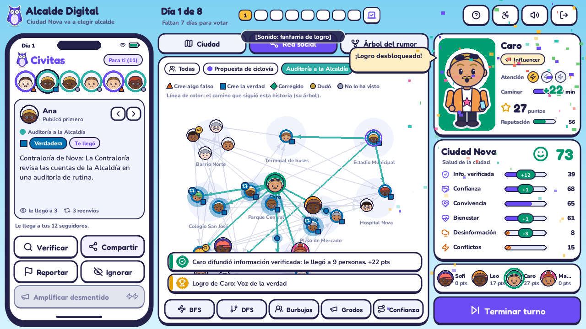
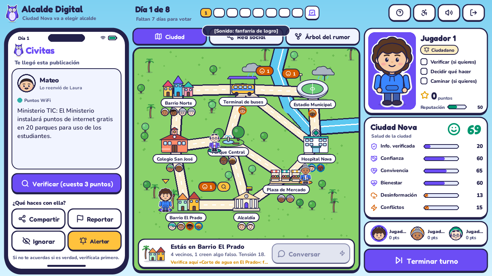
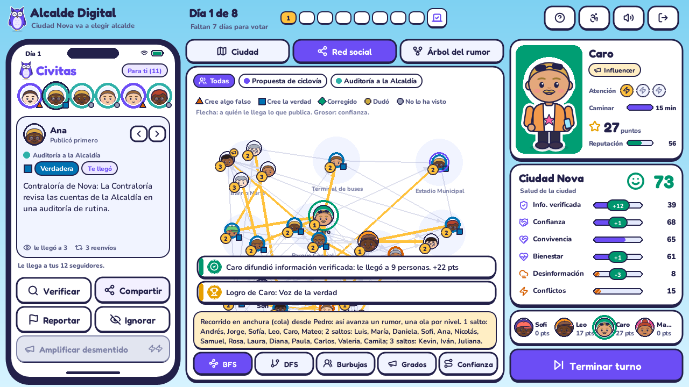
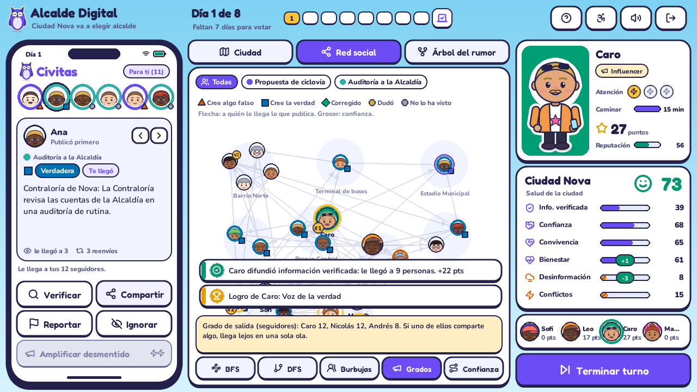
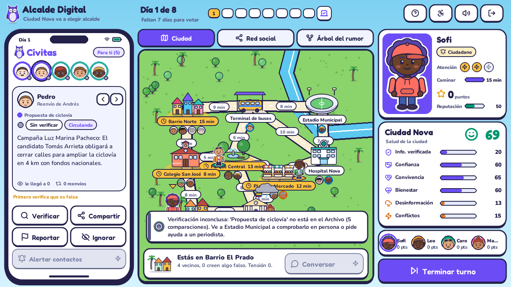

# Segunda entrega: grafos

**Alcalde Digital.** Criterios evaluados: implementación de grafos, operaciones sobre grafos, integración con los árboles, integración con la mecánica del juego y visualización gráfica del funcionamiento del grafo.

El juego usa **dos grafos**. Los dos son la misma clase (`alcalde/estructuras/grafo.py`), cada uno configurado para su problema:

| | Red social de Civitas | Mapa de Ciudad Nova |
|---|---|---|
| Variante | Grafo **dirigido y ponderado** | Grafo **no dirigido y ponderado** |
| Vértices | 20 ciudadanos, los 2 a 4 jugadores y las cuentas bot que aparecen | 9 zonas: barrios, colegio, parque, plaza, alcaldía, hospital, estadio y terminal |
| Aristas | `u → v`: **v sigue a u**, así que lo que u publica le llega a v | Calles entre zonas |
| Peso | **Confianza** de v en u, entre 0 y 1 | **Minutos** que se tarda en recorrer la calle |
| Archivo que lo crea | `alcalde/modelo/red_social.py` | `alcalde/modelo/mapa.py` |
| Para qué lo usa el juego | Propagar publicaciones, corregir creencias, detectar burbujas y superpropagadores | Moverse por la ciudad, verificar en persona, contagiar conflictos y votar por zonas |



---

## 1. Red social (grafo dirigido)

### 1.1 ¿Qué problema resuelve?

En la entrega 1 el autor de cada reenvío y la probabilidad de que ocurriera salían del azar. Así no se podía responder lo que pide el enunciado: **quién recibe** una publicación, **cuántos**, **qué tan rápido** se propaga y **qué consecuencias** tiene.

Ahora esas respuestas salen de las relaciones entre las personas:

- Una publicación **solo le llega a los seguidores** de quien la publica. Si nadie te sigue, no llega a ninguna parte. El influencer tiene 12 seguidores y por eso lo que comparte llega lejos.
- Que alguien **la crea y la reenvíe** depende de la **confianza** (peso de la arista), de qué tan crédula y activa es la persona y de si el contenido es falso. La mentira se reenvía 1,5 veces más que la verdad y los desmentidos, 0,55 veces: *la mentira viaja más rápido que la verdad*.
- Cada ciudadano tiene una **creencia** por historia: cree algo falso, cree la verdad, dudó o fue corregido. El indicador de **Desinformación** se calcula con el porcentaje de vecinos que hoy creen algo falso, así que sale directamente de la red.

### 1.2 ¿Por qué un grafo y por qué dirigido?

- Las relaciones sociales no son una jerarquía: Ana puede seguir a Luis, Luis a María y María a Ana. Hay ciclos y cada persona tiene varios contactos. Un árbol no puede representar eso; un grafo sí.
- **Seguir no es simétrico.** Muchas personas siguen a un superpropagador que no las sigue a ellas. Por eso la arista tiene dirección. La amistad se representa con las dos aristas (`u → v` y `v → u`).
- **El peso tiene significado en el juego.** La confianza cambia la probabilidad de creer y reenviar, y también cambia durante la partida: exponer al paciente cero le baja la confianza a todas sus aristas de salida, y compartir información verificada sube la que tus seguidores te tienen.

### 1.3 Representación

Lista de adyacencia con diccionarios: `_ady[u][v] = {"peso": ..., "tipo": ...}`. Además se guarda el índice inverso `_inv[v][u]` para saber **a quién sigue** cada persona (sus predecesores) sin recorrer todo el grafo. Esto se usa para escoger la publicación que le toca al jugador en su turno: se prefieren las que le llegaron de gente que sigue.

Se escogió lista de adyacencia y no matriz porque la red es dispersa: 24 vértices y unas 120 aristas, frente a 576 casillas de una matriz. Además vértices y aristas entran y salen durante la partida, y con diccionarios eso cuesta O(1).

### 1.4 Cómo se genera

1. Los 20 ciudadanos se reparten entre las 9 zonas del mapa.
2. La probabilidad de amistad depende del **grafo de la ciudad**: es de 0,65 si viven en la misma zona, 0,22 si sus zonas están conectadas por una calle y 0,05 en otro caso. Así la red social se apoya en el mapa.
3. Dos personas muy activas reciben seguidores extra: son los **superpropagadores**.
4. A quien quede con menos de 2 seguidores, o siguiendo a menos de 2 personas, se le agregan amistades con vecinos cercanos. Luego se buscan las componentes conexas (con DFS) y se unen las sueltas, para que la red empiece conexa.
5. Cada jugador entra como vértice con seguidores según su rol: ciudadano 4, periodista 6, candidato 8, influencer 12.

---

## 2. Mapa de Ciudad Nova (grafo no dirigido)



### 2.1 ¿Qué problema resuelve?

El enunciado pide que la ciudad y el personaje del jugador se vean, y que las acciones tengan consecuencias en la ciudad. El mapa le da un **lugar** a cada cosa:

- Cada hecho pasó en una zona (`Hecho.lugar`) y cada ciudadano vive en una zona.
- Cada jugador está en una zona y puede **caminar una vez por turno** a cualquier zona, por la ruta más corta.
- **En persona** se pueden hacer cosas que no se pueden hacer desde el celular:
  - **Verificar en terreno.** Si el hecho no está en el Archivo AVL, quien esté en el lugar de los hechos lo comprueba y lo **inserta** en el AVL (antes solo podía el periodista).
  - **Conversar con los vecinos.** Convence a los residentes de tu zona que creen un rumor que ya se descubrió falso.
- **Los conflictos se contagian a las zonas vecinas.** Una discusión sube la tensión de su zona en 24, la de las zonas a una calle en 12 y la de las zonas a dos calles en 6.
- **La elección se vota por zonas.** Ver la entrega final.

### 2.2 ¿Por qué un grafo no dirigido y ponderado?

Las calles se recorren en los dos sentidos y lo que importa para moverse es el tiempo de cada calle, no solo cuántas calles hay. Por eso la ruta que recorre el personaje es la de menos minutos (Dijkstra), que no siempre es la de menos calles.

---

## 3. Operaciones implementadas

Todas están en `alcalde/estructuras/grafo.py`, que no depende de nada del juego. Se prueban en `tests/test_grafos.py`.

| Operación | Método | Costo | Dónde se usa en el juego |
|---|---|---|---|
| Agregar vértice | `agregar_vertice(v, dato)` | O(1) | Aparece una **cuenta bot**; **un vecino nuevo** se une a Civitas |
| Eliminar vértice | `eliminar_vertice(v)` | O(grado de v) | Civitas **suspende la cuenta bot** cuando se reporta su publicación |
| Agregar arista | `agregar_arista(u, v, peso)` | O(1) | Generación de la red; la campaña de convivencia **reconcilia amistades rotas** |
| Eliminar arista | `eliminar_arista(u, v)` | O(1) | Una **discusión** hace que dos vecinos dejen de seguirse |
| Cambiar peso | `ajustar_peso(u, v, Δ)` | O(1) | Exponer al paciente cero, compartir lo verificado, alertar contactos |
| Vecinos y predecesores | `vecinos(u)`, `predecesores(v)`, `contactos(u)` | O(grado) | A quién le llega una publicación; la publicación que le toca al jugador; **Alertar contactos** |
| Grado y centralidad | `grado_salida`, `centralidad_grado(n)` | O(V log V) | **Superpropagadores**: la publicación viral sale con más probabilidad de quien tiene más seguidores |
| **BFS** (cola) | `bfs(origen)`, `bfs_niveles(origen, max_nivel)` | O(V + E) | **Propagación por olas**; **Amplificar desmentido** (corrige a 2 saltos); contagio de tensión entre zonas |
| **DFS** (pila) | `dfs(origen)` | O(V + E) | Base de las componentes conexas; herramienta DFS de la vista |
| Componentes conexas | `componentes_conexas()`, `es_conexo()` | O(V + E) | Detectar **burbujas**: si una discusión parte la red, el juego avisa que un grupo quedó aislado |
| **Dijkstra** (montículo) | `dijkstra(origen, costo, limite)`, `camino_mas_corto(u, v)` | O((V + E) log V) | **Moverse por el mapa** por la ruta más corta |
| Dijkstra acotado | `alcanzables(origen, limite)` | O((V + E) log V) | Zonas a las que llegas con los minutos que te quedan (se iluminan en el mapa) |
| Camino de máxima confianza | `confianza_maxima(origen)` | O((V + E) log V) | **Desmentido oficial** del candidato |
| Serializar | `a_dict()`, `desde_dict(d)` | O(V + E) | Enviar la red y el mapa del servidor a los clientes (entrega final) |

### 3.1 Camino de máxima confianza

El desmentido oficial del candidato convence a una persona solo si le llega **por gente en la que se confía**. La confianza de un camino es el **producto** de los pesos: si Ana confía 0,8 en el candidato y Luis confía 0,7 en Ana, a Luis le llega con 0,8 × 0,7 = 0,56.

Para encontrar el camino que maximiza ese producto se usa Dijkstra con costo `-log(peso)`:

- sumar logaritmos equivale a multiplicar probabilidades, porque `-log(a·b) = -log a - log b`;
- como `0 < peso ≤ 1`, el costo `-log(peso)` nunca es negativo, así que Dijkstra sirve;
- minimizar `-log` equivale a maximizar el producto.

El desmentido convence a quien está a confianza ≥ 0,12. En la vista de la red, la herramienta **Confianza** muestra ese camino y el cálculo, por ejemplo `0,80 × 0,70 × 0,75 = 0,42`.

---

## 4. Integración con los árboles

### 4.1 El árbol de mutaciones es el árbol BFS de la red

Esta es la integración central. Cada **noche** corresponde a una **ola**, y una ola es **un nivel de recorrido en anchura** sobre la red social:

```
para cada historia abierta:
    frontera = publicaciones del árbol que aún no se entregan y no están contenidas
    para cada publicación n de la frontera (en el orden del recorrido por niveles del árbol):
        para cada seguidor v del autor de n (aristas de salida en la red social):
            si v ya recibió esta historia: seguir          <- conjunto de visitados del BFS
            v la recibe por n: receptores[v] = n           <- puntero "padre" del BFS
            v la cree o duda (credulidad, confianza)
            si la cree y la reenvía: insertar(n.id, nodo de v)   <- el árbol crece un nivel
        n queda entregada
```

Por eso, en todo momento:

- cada reenvío del árbol lo hizo **un seguidor** del autor del nodo padre (`red.tiene_arista(padre.autor, hijo.autor)`);
- cada ciudadano aparece **una sola vez** por historia, como en un BFS: ningún vértice se visita dos veces;
- la **profundidad** de un nodo en el árbol es el **número de saltos** en la red desde quien publicó primero;
- el **alcance** de cada nodo es cuántos seguidores recibieron la historia por él, y la suma en **postorden** de todo el árbol es el número de personas alcanzadas (`agregar` del árbol de la entrega 1).

Todo esto se comprueba en `TestIntegracionArbolGrafo.test_arbol_es_el_arbol_bfs_de_la_red`.

En la vista **Red social**, al elegir una historia, las aristas por las que pasó se pintan de su color. Es el árbol de mutaciones dibujado **encima** del grafo.

### 4.2 Las acciones usan las dos estructuras a la vez

| Acción | Árbol | Grafo |
|---|---|---|
| Compartir | `insertar` tu reenvío | Se entrega de inmediato a tus seguidores (`vecinos`); tus aristas ganan o pierden confianza |
| Reportar | `podar` el subárbol (postorden) | Todos los que la recibieron por esa rama reciben el aviso y quedan corregidos. Si el autor era un bot: `eliminar_vertice` |
| Rastrear origen (periodista) | `camino_a_raiz` y `punto_de_mutacion` | El paciente cero queda expuesto: `ajustar_peso(-0,2)` en todas sus aristas de salida |
| Alertar contactos (ciudadano) | `inmune` en el nodo, sus hijos y los nodos de tus contactos | `contactos(jugador)`: corrige a los que creían y previene a los demás |
| Amplificar desmentido (influencer) | `punto_de_mutacion` e `inmunizar` (preorden), más `insertar` la corrección | `bfs_niveles(jugador, 2)`: corrige a uno y dos saltos |
| Desmentido oficial (candidato) | `inmunizar` e `insertar` la corrección | `confianza_maxima(jugador)`: convence a quien confía en el candidato por algún camino |
| Verificar | `buscar` en el AVL | En el mapa: si estás en el lugar de los hechos y falta en el AVL, se `inserta` |
| Conversar | (sin árbol) | `residentes(zona)` del mapa: corrige a los vecinos de tu zona |
| Moverse | (sin árbol) | `dijkstra` acotado por los minutos que te quedan |

### 4.3 Qué pasa cuando cambian las relaciones

Esta es una de las preguntas de la sustentación. Cuando una discusión **elimina una arista**, la historia deja de pasar por ahí. Si además la red queda partida en dos **componentes**, se forma una **burbuja**: ningún desmentido de afuera puede entrar. Cuando la campaña de convivencia **vuelve a agregar** esas aristas, la burbuja se abre. Cuando se **suspende un bot** (eliminar vértice), sus seguidores dejan de recibir lo que publicaba.

---

## 5. Visualización del grafo



**Vista Red social** (`alcalde/ui/vista_red.py`):

- Cada vértice es la **cara del ciudadano**. Los jugadores se ven más grandes y con su color. Las caras se agrupan alrededor de su zona del mapa.
- El **anillo y la forma** del vértice indican qué cree esa persona: triángulo naranja si cree algo falso, cuadrado azul si cree la verdad, rombo verde si fue corregido. La cara también cambia y se ve confundida si cree algo falso.
- **Grosor** de la arista = confianza. **Flecha** = a quién le llega lo que se publica. El megáfono marca a los superpropagadores.
- **Pulsos animados** recorren las aristas cuando alguien comparte y durante la ola de cada noche. Son naranjas si lo que viaja es falso, azules si es verdadero y verdes si es un desmentido. Al llegar aparece un ícono: reenvió, dudó o fue corregido.
- Una arista que se rompe se marca con una ✕ roja; una cuenta suspendida se desvanece.
- **Herramientas** para demostrar las operaciones en la sustentación:
  - **BFS**: numera los niveles desde la persona que elijas.
  - **DFS**: numera el orden de visita.
  - **Burbujas**: colorea las componentes conexas.
  - **Grados**: muestra el top 3 de seguidores.
  - **Confianza**: dibuja el camino de máxima confianza con el producto de los pesos.

**Vista Ciudad** (`alcalde/ui/vista_mapa.py`): debajo de cada edificio están las caras de sus vecinos, con su estado. Cuando una publicación viaja, se ve pasar de cara en cara por la ciudad. Al pasar el mouse por una zona se dibuja la ruta de Dijkstra y la tarjeta dice sus minutos; al hacer clic el personaje camina por esa ruta. Sobre las zonas con tensión alta aparecen nubes de tormenta.

| | |
|---|---|
|  |  |

---

## 6. Pruebas

`tests/test_grafos.py` tiene 17 pruebas:

- **Grafo:** tamaño y grados; BFS por niveles con su árbol de padres; DFS; Dijkstra y reconstrucción del camino; Dijkstra acotado; eliminar una arista que parte el grafo en dos componentes; eliminar un vértice; grafo dirigido con predecesores; camino de máxima confianza (0,9 × 0,9 = 0,81 gana a 0,5 directo); ajuste de pesos; serialización.
- **Mapa:** es conexo; caminar sigue la ruta más corta de Dijkstra y solo se puede una vez por turno.
- **Integración:** el árbol de mutaciones es el árbol BFS de la red; la desinformación sale de la red; reportar avisa a quien lo recibió; alertar usa los contactos; la elección suma bien las zonas.
- **Serialización:** el AVL se reconstruye con la misma forma; la partida completa va y vuelve por JSON sin cambiar.

```bash
python -m unittest discover -s tests -v
```
