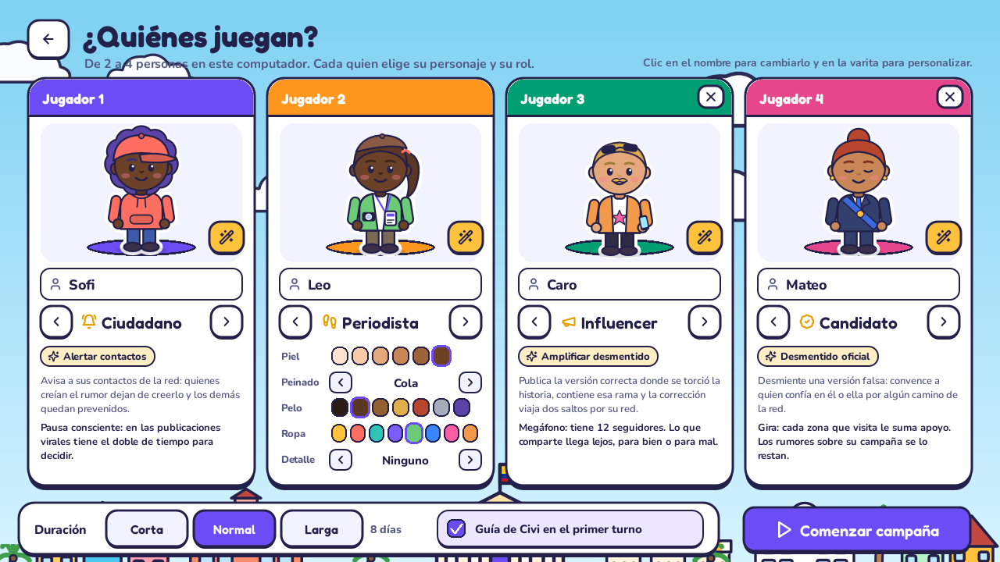
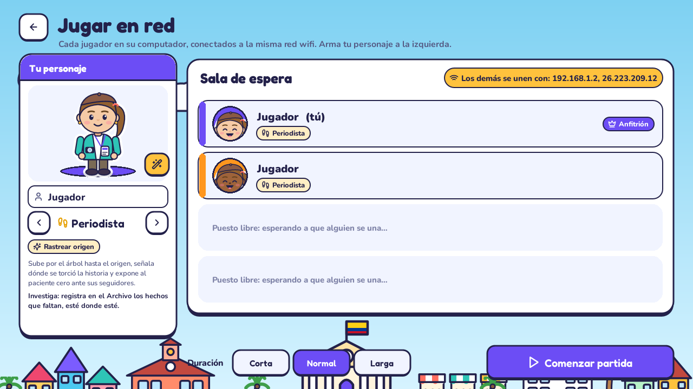
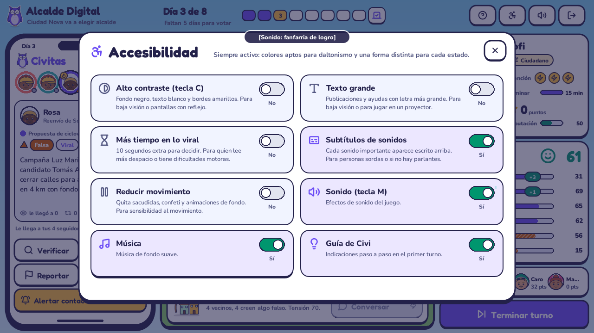
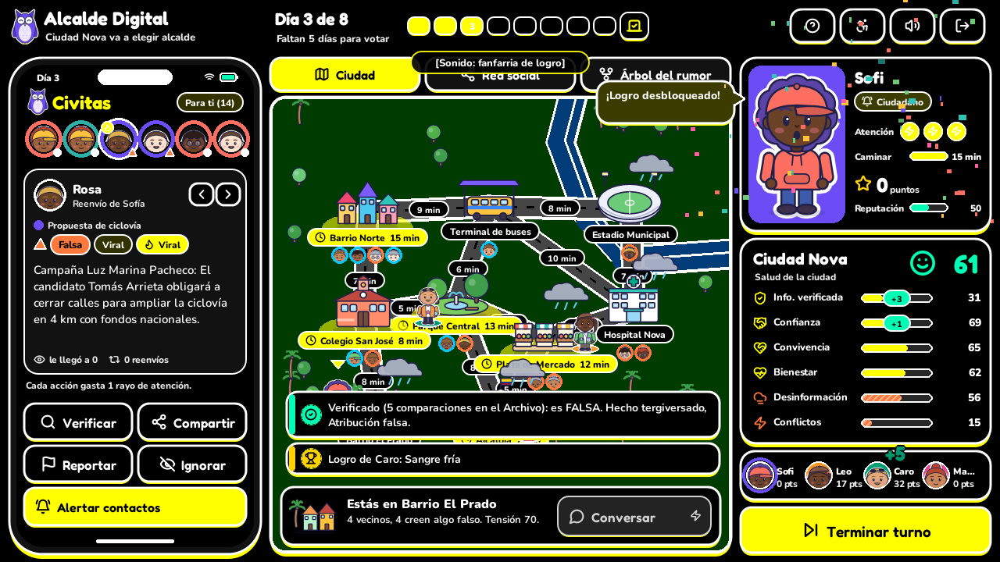
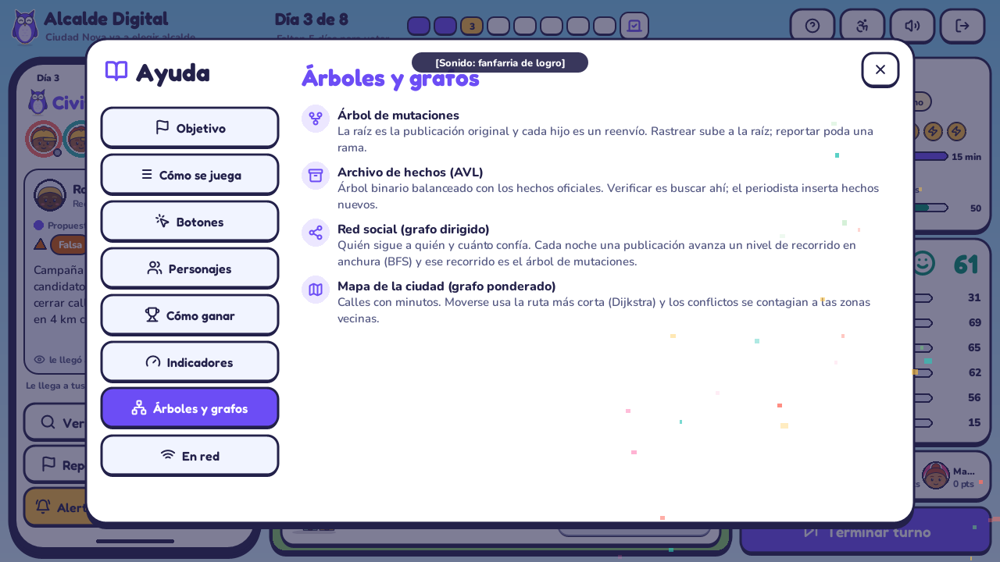
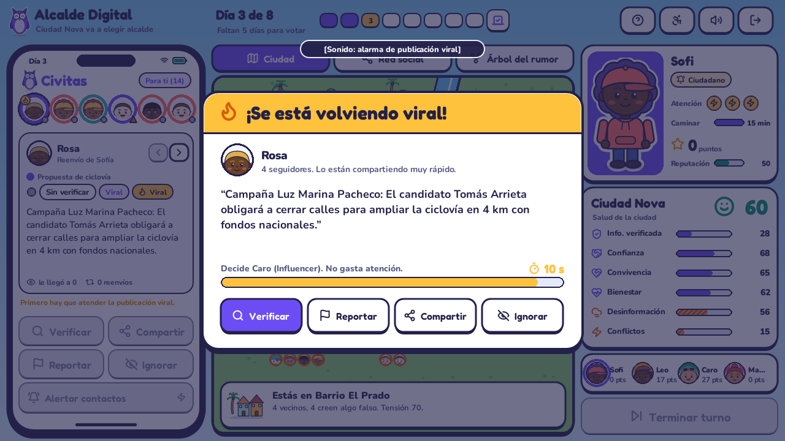
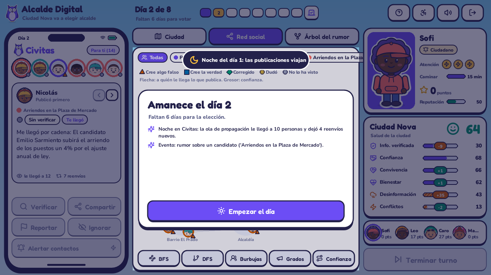
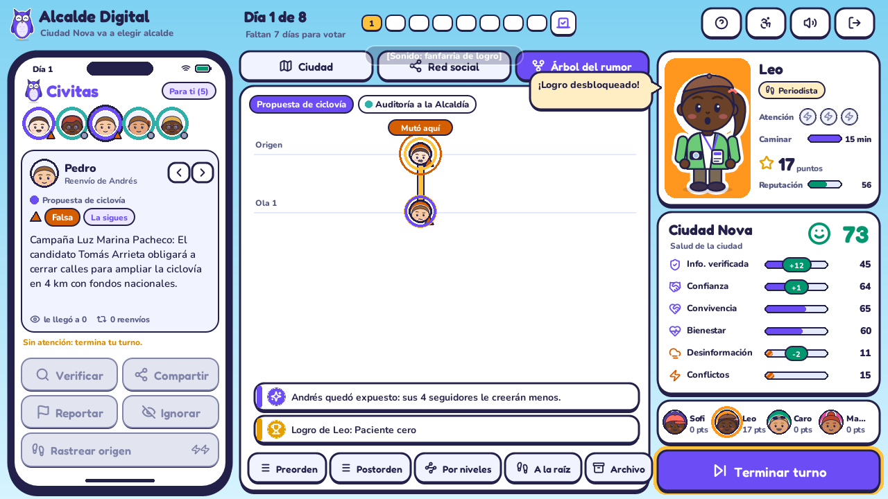
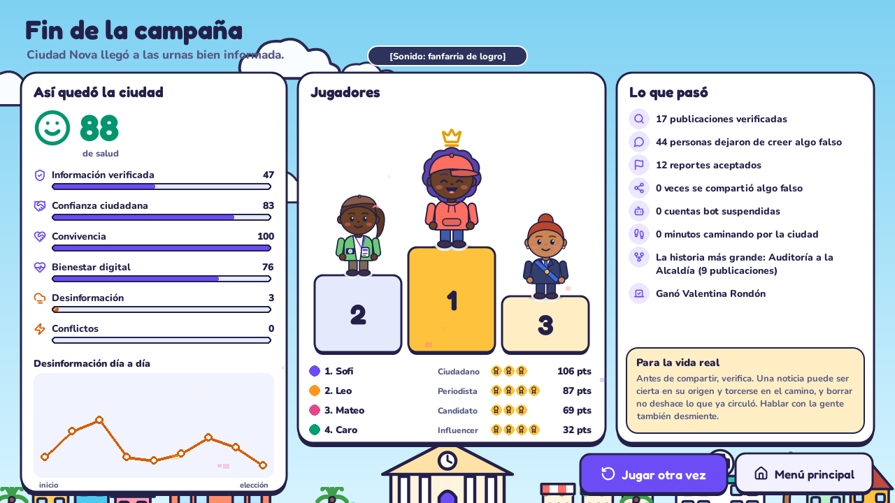

# Entrega final: producto integrado

**Alcalde Digital.** La entrega final pide el producto completo: árboles, grafos, interfaz gráfica, componente aleatorio, componente inclusivo, sistema de ayuda, elementos motivadores, modo multijugador, comunicación cliente-servidor y funcionamiento estable. Esta página resume dónde está cada cosa. Los árboles se justifican en [ENTREGA_1.md](ENTREGA_1.md) y los grafos en [ENTREGA_2.md](ENTREGA_2.md).


| Requisito | Dónde está |
|---|---|
| Árboles | Árbol de mutaciones (`estructuras/arbol_mutaciones.py`) y Archivo de hechos AVL (`estructuras/archivo_avl.py`) |
| Grafos | Red social dirigida y mapa ponderado (`estructuras/grafo.py`, `modelo/red_social.py`, `modelo/mapa.py`) |
| Interfaz gráfica | `alcalde/ui/`: menú, selección de personajes, juego con tres vistas, noche de elecciones y resultados |
| Componente aleatorio | 10 tipos de evento cada noche, mutaciones y propagación con probabilidades (`modelo/partida.py`) |
| Habilidad y tiempo | Publicación viral contra reloj, con el tiempo controlado por el servidor en red |
| Estado de la ciudad y puntuación | 6 indicadores, salud de la ciudad, puntos, reputación y 10 logros por jugador |
| Elección del alcalde | Votación por zonas según lo que cree cada vecino (`modelo/eleccion.py`, `ui/pantalla_eleccion.py`) |
| Componente inclusivo | Panel de accesibilidad con 8 opciones, paleta para daltonismo y formas por estado, personalización de personajes |
| Sistema de ayuda | Ayuda con 8 secciones, guía de Civi en el primer turno y vista previa de cada botón |
| Elementos motivadores | Personajes que reaccionan, sonidos y música, confeti, logros, puntos flotantes, noche y elección animadas |
| Multijugador cliente-servidor | Sockets TCP con un servidor que guarda la partida (`alcalde/red/`) |
| Funcionamiento estable | 34 pruebas automáticas, partidas completas con clics y una prueba de estrés de 20.000 acciones al azar |

---

## 1. Rediseño visual

En la entrega 1 la profesora comentó que el juego funcionaba bien, pero que **no había personajes** y que la interfaz era **común y opaca**. Esto fue lo que cambió.

### 1.1 Personajes



- **Todos los personajes están ilustrados** (`ui/personajes.py`). Se generan como dibujos vectoriales con:
  - 6 tonos de piel, 9 peinados, 7 colores de pelo, 8 colores de ropa y 6 detalles (gafas, barba, bigote, aretes, gorra);
  - vestuario según el rol: el ciudadano lleva saco con capota; el periodista, chaleco, cámara y carné; el influencer, chaqueta y celular; el candidato, traje y banda de campaña;
  - expresiones: normal, feliz, preocupado, enojado, sorprendido y confundido, además del parpadeo.
- **Los jugadores arman su personaje** antes de empezar, con un botón de varita mágica.
- **Los 20 ciudadanos de la red tienen cara propia**: salen en el feed, en la red social, en el árbol del rumor y en el mapa. Cuando un vecino cree algo falso, su cara se ve confundida.
- **Los 4 candidatos** tienen afiches de campaña con lema.
- **Civi, la lechuza de Civitas**, es la mascota que guía al jugador.
- **Las cuentas bot** se dibujan como robots para que se reconozcan.
- **El personaje del jugador** aparece de cuerpo entero en su panel y reacciona a lo que hace (feliz, preocupado o sorprendido, con una frase). En el mapa camina por las calles.

### 1.2 Estilo

La dirección visual es **«pegatina de campaña en una ciudad caribeña a pleno sol»**: paneles blancos con contorno de tinta y sombra dura, como las calcomanías de una campaña, sobre una Ciudad Nova soleada con edificios ilustrados (la Alcaldía con la bandera de Colombia, el colegio, la plaza de mercado, el estadio, la terminal con su buseta). Las fuentes son Fredoka (títulos y botones) y Nunito (texto). Los iconos son de Lucide.

### 1.3 Intuitivo


- **El celular funciona como cualquier red social.** Arriba están las historias (un círculo por publicación, con el color de su caso), en el centro la publicación elegida y abajo los botones fijos. Siempre están en el mismo lugar.
- **Vista previa de la consecuencia.** Al pasar el mouse por un botón se ve qué va a pasar: «Le llega a tus 6 seguidores», «Retira esta y 3 reenvíos (le llegaron a 14 personas)» o «Ese hecho no está en el Archivo: ve al Hospital». Si un botón está apagado, se explica por qué.
- **Antes de compartir algo sin verificar, Civi pregunta** si está seguro. Es un «empujón» de exactitud, una intervención que la investigación usa contra la desinformación. El jugador puede compartir igual o verificar primero.
- **Al verificar se ve la diferencia exacta** entre la publicación y el hecho oficial, con un sello de Falsa, Verdadera o Sin datos. Por ejemplo: *Cifra inflada. Dice: «durante 30 días». Oficial: «durante 3 días».*
- **La pantalla sigue a la acción.** Si compartes, pasa a la red social y ves los pulsos. Si rastreas o reportas, pasa al árbol. Si caminas, se queda en el mapa.
- **Guía de Civi** en el primer turno: 8 pasos que señalan cada parte de la pantalla. Se puede saltar.

---

## 2. Arquitectura

```
main.py ─ App (ui/app.py) ─ pantallas: menú › selección o red › juego › elección › resultados
                                   │
                         PantallaJuego (ui/pantalla_juego.py)
                         celular · mapa · red social · árbol · paneles · ventanas
                                   │  le pide las jugadas a…
                        ┌──────────┴───────────┐
               ControladorLocal         ControladorRed ── socket ──► Servidor (red/servidor.py)
               (todos en un PC)         (cada quien en su PC)             │
                        └──────────┬───────────┘                          │
                                   ▼                                      ▼
                         Partida (modelo/partida.py)  ◄──────── la misma clase, en el servidor
                         árbol de mutaciones · AVL · red social · mapa · elección
```

- **`alcalde/estructuras/`**: el árbol n-ario, el AVL y el grafo. No conocen el juego.
- **`alcalde/modelo/`**: la lógica, sin interfaz: la partida, la red social, el mapa, la elección y la serialización. Se puede probar sola.
- **`alcalde/red/`**: el protocolo, el servidor y el cliente.
- **`alcalde/controlador.py`**: la interfaz nunca modifica la partida directamente; le pide la jugada a un controlador. En local se aplica al instante; en red se envía al servidor y la interfaz se actualiza cuando llega el estado nuevo. Gracias a esto, **la misma pantalla de juego sirve para los dos modos**.
- **`alcalde/ui/`**: todo lo gráfico en Pygame.

---

## 3. Multijugador cliente-servidor



### 3.1 Cómo se juega en red

1. Un computador elige **Jugar en red › Crear partida**. Ese computador abre el servidor (puerto 5050) y también juega. La pantalla muestra su dirección, por ejemplo `192.168.1.20`.
2. Los demás, conectados a la misma red wifi, eligen **Unirse** y escriben esa dirección.
3. Cada quien arma su personaje. El anfitrión elige la duración y pulsa **Comenzar partida**.

También se puede correr un servidor dedicado sin ventana:

```bash
python servidor.py --puerto 5050
```

Windows puede preguntar si se permite el acceso por el firewall; hay que permitirlo en redes privadas.

### 3.2 Arquitectura del servidor

```
                     SERVIDOR (red/servidor.py)
        hilo «aceptar»  ──►  un hilo «lector» por cliente
                                    │  (mensaje)
                                    ▼
                          cola de mensajes (queue.Queue)
                                    │
                                    ▼
                      hilo «juego»: único que toca la Partida
                      valida turno ─► aplica jugada ─► envía el estado a todos
          ┌──────────────┬──────────┴───┬──────────────┐
      CLIENTE 1      CLIENTE 2      CLIENTE 3      CLIENTE 4
      Ciudadano      Periodista     Influencer     Candidato
```

- **Un solo hilo modifica la partida.** Los hilos lectores solo ponen mensajes en una cola, así que nunca hay dos jugadas aplicándose a la vez. No hacen falta candados sobre el modelo.
- **El servidor es la autoridad.** Valida que quien envía la jugada tenga el turno (o sea quien decide la publicación viral). Las jugadas fuera de turno se rechazan con un aviso. La partida, el azar y el reloj de lo viral viven solo en el servidor.
- **El reloj de lo viral es del servidor.** Cuando aparece una publicación viral, el servidor fija un plazo: 10 segundos, 20 si decide el ciudadano y 10 más si ese jugador activó «Más tiempo». Si se vence, la resuelve sin respuesta. Los clientes muestran la cuenta regresiva con el tiempo que les envía.
- **Desconexiones.** En la sala de espera se libera el puesto. En la partida, el jugador queda marcado sin conexión y, si es su turno, se le pasa a los 20 segundos.

### 3.3 Protocolo

Cada mensaje es **un objeto JSON en una línea** (UTF-8) sobre TCP (`red/protocolo.py`).

| Cliente › servidor | Para qué |
|---|---|
| `hola`, `perfil` | Entrar a la sala y cambiar nombre, rol, apariencia y la opción de más tiempo |
| `iniciar` | Comenzar la partida (solo el anfitrión, con 2 a 4 jugadores) |
| `accion` | Verificar, compartir, reportar, ignorar, especial o borrar (`caso`, `nodo`, `clave`) |
| `mover`, `conversar`, `fin_turno` | Caminar a una zona, conversar con los vecinos, terminar el turno |
| `viral` | Respuesta a la publicación viral |

| Servidor › cliente | Para qué |
|---|---|
| `bienvenida` | Identificador de la conexión |
| `lobby` | Jugadores conectados y quién es el anfitrión |
| `estado` | Estado completo de la partida, qué jugador eres (`tu`), tiempo viral restante y desconectados |
| `aviso` | Errores y avisos («Espera tu turno», «Se desconectó…») |

### 3.4 Qué se sincroniza y cómo se serializan las estructuras

El servidor envía el **estado completo** después de cada jugada (`modelo/serializacion.py`). Pesa entre 20 y 65 KB, nada para una red local. Incluye la partida, los jugadores, las publicaciones, las relaciones, los eventos, las puntuaciones, los turnos y la información compartida. El cliente reconstruye con eso una Partida «espejo» con las mismas estructuras, y la interfaz la dibuja igual que en local.

- **Árbol de mutaciones**: se envía en **preorden** con el id del padre de cada nodo. Como en preorden cada padre llega antes que sus hijos, se reconstruye **insertando en ese mismo orden**.
- **Archivo AVL**: se envía su **preorden**. Reinsertarlo en un AVL dispararía rotaciones, porque todo el subárbol izquierdo llega antes que el derecho, y la forma cambiaría. Por eso `ArchivoHechosAVL.desde_preorden` lo reconstruye **sin rotar**, tomando cada clave como raíz de su rango (lo, hi), como en un BST. Así el cliente ve exactamente el mismo árbol, con sus alturas y factores de balance. La prueba `test_avl_desde_preorden_conserva_la_forma` lo comprueba.
- **Grafos**: lista de vértices (con los datos de cada ciudadano) y lista de aristas con sus pesos.
- **Animaciones**: la partida guarda una lista numerada de eventos de animación (pulsos de la ola, rutas, aristas rotas, etc.). Cada cliente reproduce los que no ha visto, así que todos ven la propagación al mismo tiempo.

La prueba `tests/test_red.py` levanta un servidor real con 3 clientes por sockets, juega una partida completa, intenta jugadas fuera de turno y comprueba que todos terminan con el mismo estado y el mismo alcalde.

---

## 4. Elección del alcalde


Al terminar el último día, **cada zona del mapa vota** (`modelo/eleccion.py`):

1. **Puntaje de cada candidato en la zona** = apoyo general + apoyo ganado en la zona por la gira del candidato-jugador − castigo por rumores.
2. **Castigo por rumores**: si los residentes de la zona creen una versión falsa contra un candidato, ese candidato pierde puntaje ahí. El castigo es proporcional a la fracción de vecinos engañados.
3. **Participación**: sube con la convivencia y el bienestar, y baja con los conflictos y con la tensión de la zona.
4. Los votos se reparten según el puntaje (al cuadrado, para que las diferencias pesen) entre los votantes de la zona.
5. Si un jugador es **candidato**, su reputación, sus verificaciones y las personas que corrigió le suman apoyo. Esto cumple el enunciado: más confianza, reputación y verificación significan más votos.
6. Se calcula también la **elección sin rumores**. Si el ganador cambia, la pantalla lo dice: «La desinformación cambió la elección: sin rumores habría ganado…». Si no, muestra cuántos votos le quitaron los rumores a cada candidato.

En la pantalla se cuentan las zonas una por una, las barras crecen y al final se anuncia quién gana, con fuegos artificiales. En simulaciones de 30 partidas, un candidato-jugador responsable gana casi siempre, uno que juega al azar gana alrededor del 60 % de las veces y uno irresponsable casi nunca. Sin candidato-jugador, el ganador varía entre partidas.

---

## 5. Componente aleatorio

Cada noche ocurre **un evento al azar**. El resultado varía entre partidas, salvo si se usa una semilla fija (`python main.py 42`).

| Evento | Qué hace | Estructura que toca |
|---|---|---|
| Noticia falsa | Nueva historia con dos distorsiones | Árbol nuevo; primera ola por la red |
| Rumor sobre un candidato | Historia con atribución falsa | Árbol nuevo; castiga al candidato en la elección |
| Noticia verdadera | Historia fiel al hecho | Árbol nuevo |
| Publicación viral | La publicación de un superpropagador, contra reloj | Grado de salida (centralidad) |
| Discusión | Dos vecinos dejan de seguirse y la tensión se contagia | Eliminar arista; BFS en el mapa; componentes (burbujas) |
| Campaña de convivencia | Baja la tensión cerca y reconcilia amistades | BFS en el mapa; agregar aristas |
| Un ciudadano reporta | Civitas retira un reenvío falso | Podar el árbol |
| Un hecho vence | Sale del Archivo | Eliminar en el AVL |
| Cuenta bot | Aparece un bot con 8 seguidores que publica un rumor | Agregar vértice; si lo reportan, se elimina |
| Vecino nuevo | Alguien se muda y se une a Civitas | Agregar vértice y aristas |

Además son aleatorios quién cree y quién reenvía en cada ola, qué distorsión aparece al mutar y cómo se genera la red social. Pero **la habilidad importa**: en 30 partidas simuladas, jugar de forma responsable deja la ciudad con salud ~90, jugar al azar con ~63 y jugar de forma irresponsable con ~16.

---

## 6. Componente inclusivo



| Característica | Dificultad que atiende |
|---|---|
| **Colores aptos para daltonismo** (paleta Okabe-Ito, siempre activa) y **una forma por estado** (círculo, cuadrado, triángulo, rombo) | Daltonismo: el estado de una publicación o de un vecino nunca depende solo del color |
| **Alto contraste** (tecla C): fondo negro, texto blanco, bordes amarillos; el texto sobre fondos claros pasa a negro | Baja visión; pantallas con reflejo o proyectores |
| **Texto grande** en publicaciones y ayudas | Baja visión; lectura a distancia en la feria |
| **Más tiempo en lo viral** (+10 s, también en red) | Lectura lenta, dislexia o dificultades motoras |
| **Subtítulos de sonidos**: cada sonido importante aparece escrito («Sonido: alarma de publicación viral») | Personas sordas o con hipoacusia, o juego sin parlantes |
| **Reducir movimiento**: quita sacudidas, confeti y animaciones de fondo | Sensibilidad al movimiento, epilepsia fotosensible o distracción |
| **Personalización de personajes**: tono de piel, peinado, ropa y detalles | Representación: cada quien puede verse en su personaje |
| **Atajos de teclado** para las acciones del turno (1 a 6, Enter, Tab, flechas, H, C, M, Esc) | Menos precisión con el mouse; jugar más rápido |

Las opciones se guardan en el computador (`~/.alcalde_digital.json`).



---

## 7. Sistema de ayuda

- **Ayuda** (botón «?» o tecla H) con 8 secciones: Objetivo, Cómo se juega, Botones, Personajes, Cómo ganar, Indicadores, Árboles y grafos, y En red. Cubre todo lo que pide el enunciado: objetivo, reglas, funciones de los botones, funciones de cada personaje, forma de ganar y significado de los indicadores.
- **Guía de Civi** en el primer turno, paso a paso.
- **Indicaciones durante la partida**: vista previa de cada botón, motivo cuando un botón está apagado, avisos de cada acción, la pregunta antes de compartir sin verificar, el resumen de cada noche y el globo de diálogo del personaje.
- **Descripción de cada indicador** al pasar el mouse por él.



---

## 8. Elementos motivadores

Ninguno es solo decoración. Cada uno le dice algo al jugador:

- **El personaje reacciona**: sonríe si la acción ayudó a la ciudad, se preocupa si le hizo daño y celebra un logro.
- **Puntos flotantes** (+10, −7) sobre quien jugó y **cambios de cada indicador** que aparecen y se desvanecen.
- **Sonidos sintetizados** (`tools/generar_audio.py`, sin grabaciones de terceros): acierto, error, sello al verificar, alarma viral, noche, conteo de votos, fanfarria. Hay música de fondo tropical suave.
- **Confeti** al lograr algo y **fuegos artificiales** en la elección. La pantalla se sacude cuando algo sale mal.
- **10 logros**: Primer chequeo, Paciente cero, Poda limpia, Sangre fría, Voz de la verdad, Cortafuegos, Vecino ejemplar, Caza-bots, Investigador y Mano limpia. Además está la Alcaldía de Ciudad Nova, para el candidato que gana.
- **La noche**: la pantalla se oscurece, las publicaciones viajan por la red y luego amanece con el resumen del día.
- **Cambios visuales con sentido**: nubes de tormenta sobre las zonas con tensión, caras confundidas en quienes creen algo falso, la salud de la ciudad con una cara.
- **Podio final** y «Lo que pasó en la campaña», con un mensaje para la vida real.

| | |
|---|---|
|  |  |
|  |  |

---

## 9. Funcionamiento estable

- **34 pruebas automáticas** (`python -m unittest discover -s tests -v`), en menos de un segundo:
  - 14 de los árboles y de la partida (entrega 1);
  - 17 de los grafos, su integración con los árboles y la serialización;
  - 3 de cliente-servidor con sockets reales.
- **Partidas completas con clics reales**: un guion juega de principio a fin con 4 jugadores, en local y en red (dos procesos del juego conectados al servidor). Pasa por la selección, la guía, las verificaciones, la publicación viral, las noches, la elección y los resultados.
- **Prueba de estrés**: 20.000 clics, teclas y movimientos al azar en todas las pantallas, con 4 semillas, sin ningún error. Esta prueba encontró y permitió corregir un caso en que una animación del mapa podía cerrar el juego.
- **Rendimiento**: cada cuadro se dibuja en unos 5 ms (el juego va a 60 cuadros por segundo). Las ilustraciones se dibujan una vez y se guardan en caché.

---

## 10. Para la sustentación

**¿Por qué un árbol?** Cada reenvío sale de exactamente una publicación anterior y ninguna es su propio ancestro. Eso es un árbol. El subárbol de una publicación es todo lo que depende de ella, así que reportar es podar. Subir por el camino a la raíz encuentra el reenvío exacto donde apareció cada mentira. El AVL guarda los hechos oficiales con búsqueda, inserción y eliminación en O(log n) y en orden alfabético.

**¿Por qué un grafo?** Las relaciones entre personas tienen ciclos y varios contactos por persona, y seguir a alguien no es simétrico. Las calles de una ciudad forman una red con distancias. Ninguna de las dos cosas es una jerarquía.

**¿Qué problema resuelve cada estructura?** El árbol de mutaciones guarda *qué pasó* con una historia. La red social decide *a quién le puede llegar* y *quién la cree*. El AVL permite *verificar*. El mapa le da *lugar* a la ciudad: dónde estás, a dónde llegas, dónde pasó cada hecho y quién vota dónde.

**¿Cómo afectan las decisiones del jugador?** Compartir inserta en el árbol y entrega por la red a tus seguidores. Reportar poda y avisa a quienes lo recibieron por esa rama. Alertar, amplificar y desmentir usan vecinos, BFS y el camino de máxima confianza. Moverse usa Dijkstra.

**¿Qué ocurre cuando cambia la información o las relaciones?** Si una discusión elimina una arista, la historia deja de pasar por ahí; si la red se parte en componentes, se forma una burbuja que los desmentidos de afuera no alcanzan. Si se expone al paciente cero, sus aristas pierden confianza y sus próximos rumores llegan menos lejos. Si se suspende un bot, sus seguidores dejan de recibir lo que publicaba.

**¿Cómo se comunica la información entre los jugadores?** Por sockets TCP con mensajes JSON. El servidor guarda la partida, valida los turnos y envía a todos el estado completo después de cada jugada. Los árboles y los grafos viajan serializados; ver la sección 3.4.

**¿Qué comportamiento busca fomentar?** Verificar antes de compartir. Entender que una noticia puede ser cierta en su origen y deformarse en el camino. Saber que reportar lo verdadero también hace daño y que borrar no deshace lo que ya circuló. Ver que hablar con la gente cara a cara también desmiente, y que la desinformación puede cambiar el resultado de una elección.

---

## Recursos de terceros

- Fuentes **Fredoka** y **Nunito**, con licencia SIL Open Font License 1.1 (`assets/fuentes/OFL-*.txt`).
- Iconos **Lucide**, con licencia ISC (`assets/iconos/LICENSE-lucide.txt`).
- Personajes, edificios, mascota, sonidos y música: hechos para este proyecto. Las ilustraciones salen del código de `ui/personajes.py` y `ui/edificios.py`; el audio, de `tools/generar_audio.py`.
