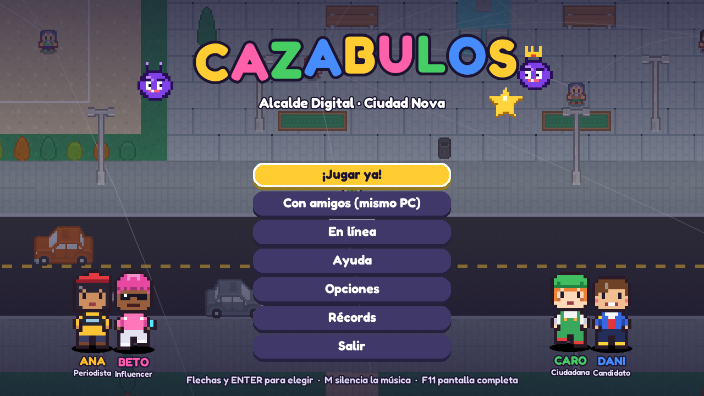
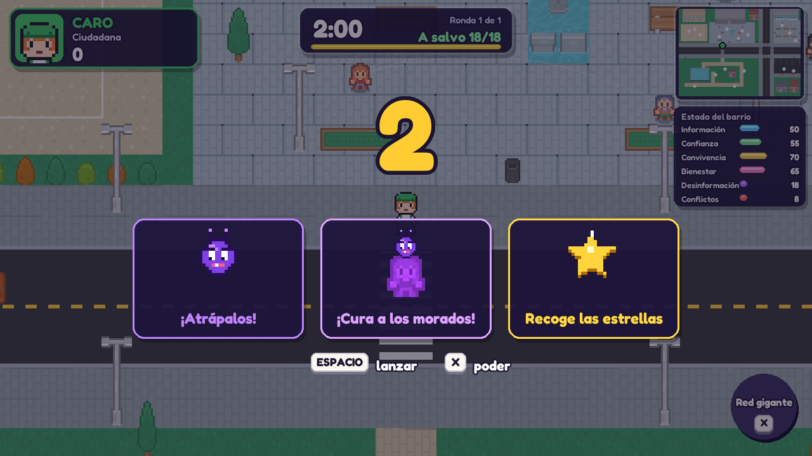
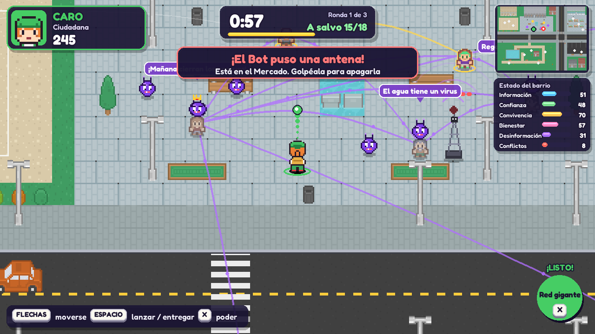
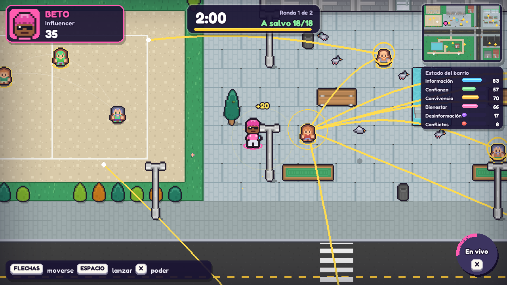
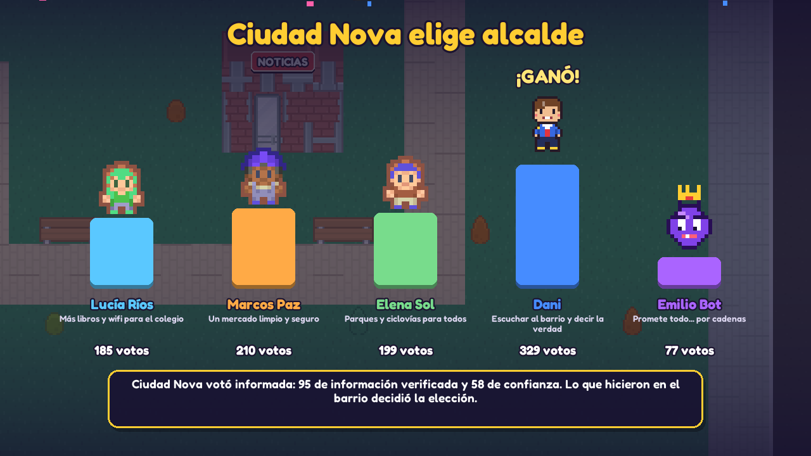
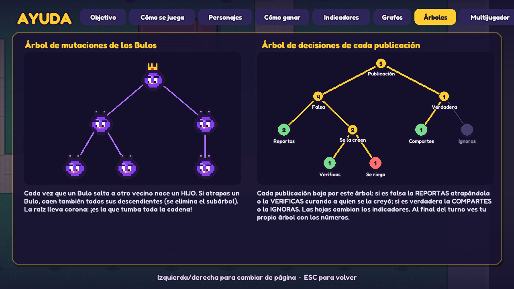
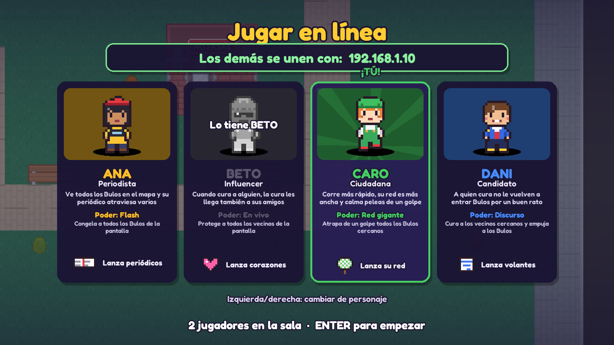
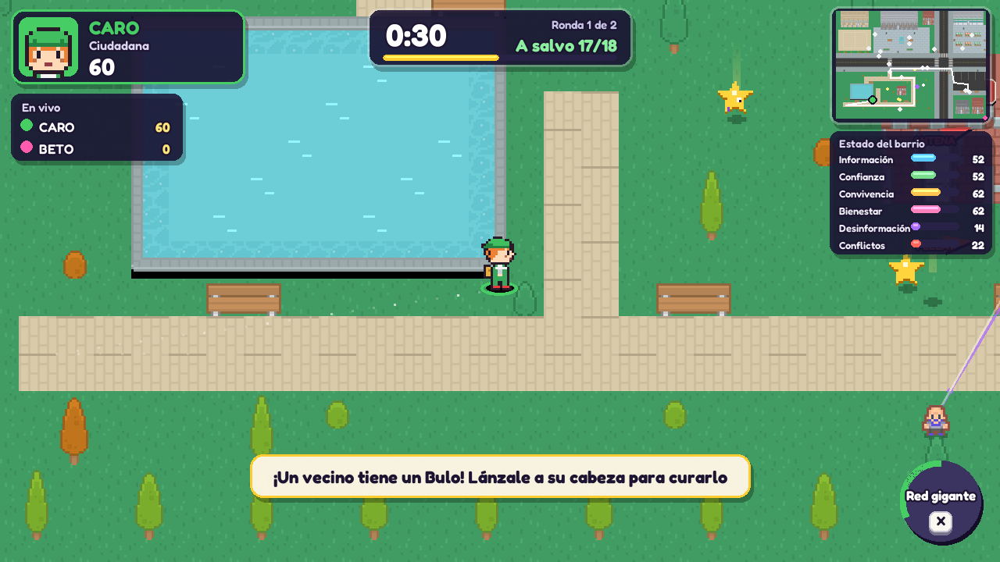

# Entrega final · Cazabulos (Alcalde Digital)

Cómo cumple el juego cada punto del enunciado, y las respuestas a las preguntas de la sustentación.


## 1. La idea

Caminas con tu personaje por un barrio de Ciudad Nova (un mapa de 64 x 46 tiles, unas 3 pantallas, con cámara que te sigue). Los **Bulos** (publicaciones falsas) salen de la antena del Bot y vuelan hacia los vecinos; si llegan, se les suben a la cabeza y el vecino se vuelve **morado**. Un vecino morado, si nadie lo cura, le pasa el Bulo a un amigo por su hilo de la red social. Tú atrapas los Bulos, curas a los morados lanzándoles tu herramienta, compartes las **estrellas** (noticias verdaderas), calmas peleas y apagas antenas. Gana quien salve a más vecinos.

El aprendizaje sale de las mecánicas, no de preguntas:
- quien se creyó un rumor se puede **verificar** (curar) antes de que lo riegue;
- **compartir lo verdadero** protege a la gente y a sus amigos;
- cortar el **origen** de una cadena la detiene entera;
- las personas **más conectadas** riegan más rápido, para bien o para mal;
- las peleas sin calmar **rompen la comunidad**.

## 2. Requisitos del enunciado

| Punto del enunciado | Dónde está en el juego |
|---|---|
| 2 a 4 jugadores con roles distintos | Ana (Periodista), Beto (Influencer), Caro (Ciudadana), Dani (Candidato). Cada uno lanza algo distinto y tiene una ventaja y un poder propios (`cazabulos/mundo.py`, `ROLES`). Ninguno es más fuerte: con el mismo jugador automático (20 partidas de 2 minutos por personaje) los cuatro quedan a menos de 10 % de distancia en puntos. |
| Decidir qué hacer con cada publicación (compartir, verificar, ignorar, reportar) | Son las acciones del juego y las ramas del árbol de decisiones: atrapar un Bulo en el aire es **reportarlo**; curar a quien se lo creyó es **verificar**; tocar una estrella es **compartirla**; dejar pasar una estrella que tuviste en frente es **ignorarla**. |
| Periodista detecta noticias falsas | Ana ve en el minimapa todos los Bulos sueltos (los demás no) y su periódico atraviesa varios Bulos de un tiro. Su poder congela a los Bulos de la pantalla. |
| Influencer con mayor impacto | Cuando Beto cura a alguien, la cura les llega también a los amigos de ese vecino (BFS de un nivel). Las estrellas que comparte llegan dos niveles en la red (las de los demás, uno). |
| Candidato construye confianza y enfrenta rumores | A quien cura Dani no le vuelven a entrar Bulos por un buen rato, gana más puntos por cada vecino curado y por cada rumor sobre un candidato que atrapa, su Discurso cura a los vecinos cercanos y, si alguien juega con Dani, Dani aparece en la elección. |
| Ciudadano que cuida la convivencia | Caro corre más rápido, su red es más ancha y calma una pelea de un solo golpe (los demás necesitan dos). |
| Árboles y grafos con función real | Ver la sección 3. |
| Propagación por el grafo social | Cada vecino morado le pasa el Bulo al amigo en quien más confía (la arista de mayor peso), como una bolita que viaja por el hilo. En los últimos 3,5 segundos se ve una línea punteada hacia ese amigo. El viral se riega por BFS (hasta 2 niveles y como máximo 5 vecinos, en el orden del recorrido). La verdad de las estrellas también se riega por BFS. |
| Quién recibe, cuántos, qué tan rápido, si es verdad, qué consecuencias | **Quién:** el BFS da quiénes y en qué orden (y el amigo de más confianza en cada reenvío). **Cuántos:** el árbol de decisiones cuenta cuántas veces se regó y el aviso dice el tamaño de cada cadena cortada. **Qué tan rápido:** los vecinos con más amigos reenvían antes (entre 7,5 y 14 segundos según su grado). **Si es verdad:** las publicaciones falsas son Bulos morados y las verdaderas son estrellas doradas, y las dos viajan por el mismo grafo. **Consecuencias:** las hojas del árbol cambian los indicadores, los puntos y la elección. |
| Componente aleatorio | Eventos: aparece una noticia falsa (un grupo de Bulos), Bulo viral, rumor sobre un candidato, discusión entre vecinos, noticias verdaderas, campaña de convivencia y un vecino que reporta. Cambian en cada partida (semilla), pero dentro de una ronda son los mismos para todos los jugadores. |
| Habilidad y decisión con tiempo límite | El **Bulo viral** aparece con 10 segundos en pantalla y hay que golpearlo 3 veces; si no, se riega por BFS. También cada vecino morado da 3,5 segundos de aviso antes de pasar el Bulo, y cada pelea tiene un reloj antes de romper la amistad: el jugador decide a qué atender primero. |
| Estado de la ciudad | 6 indicadores en vivo: información verificada, confianza, convivencia, bienestar digital, desinformación y conflictos (`Mundo.indicadores`). |
| Puntuación individual y resultado general | Puntos por jugador, bono por vecinos a salvo y estrellas de reputación (3 con 14 o más vecinos a salvo, 2 con 9 o más). La ciudad tiene sus indicadores y la elección. |
| Logros, recompensas y retroalimentación | 14 logros guardados (`cazabulos/guardado.py`), combos, puntos que saltan, avisos cortos (¡CADENA DE 3!), un mensaje final que va con las estrellas y el árbol de decisiones del turno. |
| Elección del alcalde | `calcular_eleccion` en `cazabulos/partida.py`. La regla es clara para los niños: si la desinformación promedio de todos los turnos llega a 50 (la mitad del barrio se creyó los Bulos), gana Emilio Bot. Si no, gana el candidato honesto con más votos; esos votos salen de la confianza, la convivencia, el bienestar y los rumores frenados o creídos sobre cada uno. |
| Multijugador cliente-servidor con sockets | `cazabulos/red/`: servidor TCP con hilos y mensajes JSON. Sincroniza la sala, los jugadores y sus personajes, las rondas (semilla y duración), las posiciones y puntajes en vivo, los avisos, los resultados de cada ronda y los finales. |
| Interfaz gráfica | Todo en pygame: ciudad, personaje, publicaciones (Bulos y estrellas), opciones, estado, puntuación, indicadores y resultados. |
| Inclusividad | Ver la sección 5. |
| Sistema de ayuda | Pantalla AYUDA de 8 páginas: objetivo, cómo se juega, personajes, cómo ganar, indicadores, grafos, árboles y multijugador. Durante la partida orientan: la cuenta regresiva con tres dibujos, flechas con dibujos hacia lo que no se ve, la línea de Dijkstra hacia lo más urgente y una pista corta la primera vez que alguien se vuelve morado. |
| Elementos motivadores | Música y efectos, animaciones, partículas, temblor de cámara, confeti, podio, logros, récords, combos, estrellas de reputación y mensajes. |

## 3. Las estructuras de datos

### Grafo social (`cazabulos/estructuras/grafo.py`, `cazabulos/ciudad.py`)

- **Qué representa:** 18 vecinos (vértices) y 29 amistades (aristas no dirigidas con peso de confianza 1 a 3). Rosa es "la del grupo de chat" y tiene 7 amigos.
- **Para qué sirve:**
  - **Propagación de los Bulos:** cada vecino morado se lo pasa al amigo de mayor peso (el que más confía).
  - **Propagación de la verdad:** al tocar una estrella, un **BFS** desde el vecino más cercano lleva la verdad a sus amigos (1 nivel; con Beto, 2).
  - **Viral:** se riega con **BFS** limitado a 2 niveles y con un filtro (los vecinos protegidos no lo reciben ni lo pasan).
  - **Objetivo de los Bulos:** buscan al vecino de mayor **grado**.
  - **Velocidad:** el tiempo para reenviar depende del grado (los más conectados reenvían antes).
  - **Comunidades:** **DFS / componentes**.
- **Se ve en el juego:** los hilos por donde viaja un Bulo son morados; la verdad se ve crecer en dorado nivel por nivel; las amistades nuevas brillan en verde. Al final de cada turno, la tecla TAB muestra la red del barrio en anillos del BFS desde el vecino más conectado: quién quedó con Bulo, quién protegido, las amistades rotas (rojo) y las nuevas (verde), y cuántas comunidades quedaron (DFS). La ayuda dibuja el grafo igual, con cada anillo de un color.
- **Cambia durante la partida:**
  - Si una pelea no se calma, la amistad se rompe (**eliminar arista**) y por ahí ya no pasa nada, ni Bulos ni verdad.
  - Si se calma, la confianza sube (el peso aumenta).
  - La campaña de convivencia crea amistades nuevas (**agregar arista**).

### Grafo de la ciudad (`cazabulos/mapa.py` `NODOS`/`ARISTAS`, `cazabulos/ciudad.py`)

- **Qué representa:** 28 lugares y esquinas (Colegio, Plaza, Alcaldía, Mercado, Parque, Kiosco, Terminal…) unidos por tramos de calle con peso = distancia. Cada tramo se comprueba contra las colisiones del mapa: no se usa uno que atraviese un edificio.
- **Para qué sirve:**
  - **Dijkstra** da la ruta más corta para la línea guía del jugador hacia lo más urgente que no se ve: el viral, una pelea, el vecino morado más cercano o la antena. La ruta se ve en el piso y en el minimapa.
  - Los vecinos la usan para ir de una zona a otra.

### Árbol de mutaciones (`cazabulos/estructuras/arbol_mutaciones.py`)

1. **Problema:** saber de dónde salió cada copia de un rumor y poder cortar la cadena desde su origen.
2. **Por qué un árbol:** cada Bulo tiene exactamente un padre (el que lo originó) y puede tener muchos hijos. Es una jerarquía sin ciclos.
3. **Variante:** árbol general (n-ario) con lista de hijos y referencia al padre. Hay un bosque de raíces: cada antena o evento crea una raíz.
4. **Insertar y eliminar:**
   - Insertar: cuando un Bulo salta a otro vecino, el nuevo Bulo se inserta como hijo.
   - Eliminar: al atrapar un Bulo se elimina **todo su subárbol**. Por eso la raíz (con corona) tumba toda la cadena y cura a todos los de esa cadena.
5. **Recorridos:** preorden para la animación de la cadena que cae; también postorden, por niveles, altura, tamaño y camino a la raíz.

### Árbol de decisiones de cada publicación (`cazabulos/estructuras/arbol_decision.py`)

```
                  PUBLICACIÓN
                 /           \
           falsa (Bulo)     verdadera (estrella)
           /        \           /         \
   La atrapas    Alguien     La compartes  La dejas pasar
   (REPORTAR)   se la cree   (COMPARTIR)   (IGNORAR)
                 /      \
          Lo curas     Se la pasa
         (VERIFICAR)   a un amigo
```

1. **Problema:** toda publicación termina de una forma, y cada final tiene consecuencias distintas en los indicadores. Las reglas quedan en un solo lugar.
2. **Por qué un árbol:** son decisiones encadenadas que se abren en opciones y terminan en un resultado (hoja), igual que el ejemplo del enunciado.
3. **Variante:** árbol general con aristas etiquetadas; las hojas guardan el efecto (puntos e indicadores).
4. **Insertar y eliminar:** `insertar(padre, etiqueta, nodo)` agrega una rama y `eliminar(clave)` quita la rama completa.
5. **Recorridos:**
   - `recorrer(etiquetas)` baja desde la raíz siguiendo lo que pasó y cuenta las visitas.
   - Preorden para dibujarlo al final del turno con los números.
   - Por niveles y camino a una hoja.
6. **Cómo se usa en el juego:**
   - Cada Bulo atrapado en el aire baja por *falsa → atrapar*.
   - Cada vecino curado baja por *falsa → llega → curar*.
   - Cada reenvío que llega baja por *falsa → llega → pasar*.
   - Cada estrella tocada baja por *verdadera → compartir*.
   - Cada estrella que estuvo en la pantalla del jugador y desapareció baja por *verdadera → ignorar*.

### AVL (`cazabulos/estructuras/avl.py`)

La tabla de récords: inserción y eliminación balanceadas, recorrido en orden inverso para el top 10, y se elimina el menor cuando hay más de 200.

## 4. Arquitectura en línea

```
            SERVIDOR (cazabulos/red/servidor.py)
     sala · rondas · semillas · marcador · resultados
        /              |               \
   CLIENTE 1        CLIENTE 2        CLIENTE 3 ...
   (Ana)            (Beto)           (Caro)
```

- **Mensajes (JSON, uno por línea, TCP):**
  - Del cliente al servidor: `hola`, `elegir`, `empezar`, `estado`, `resultado`, `listo`.
  - Del servidor a los clientes: `sala`, `ronda`, `marcador` (6 veces por segundo), `aviso`, `fin_ronda`, `fin`.
- **Cómo se juega:** cada cliente simula su propio barrio con la semilla que le da el servidor, así nadie depende de la conexión de otro para jugar. El servidor junta los resultados de todos para la tabla y la elección.
- **Cómo se abre la sala:** el que crea la sala corre el servidor dentro del juego. También existe `python -m cazabulos.red.servidor` para un servidor dedicado.

## 5. Inclusividad

- **Pocas palabras y muchos dibujos:**
  - El juego se explica antes de cada turno con tres dibujos ("¡Atrápalos!", "¡Cura a los morados!", "Recoge las estrellas").
  - Las flechas hacia lo que no se ve llevan un dibujo, no una palabra.
  - Durante el juego solo aparecen avisos de una o dos palabras.
  - Atiende a niños pequeños que todavía leen despacio y a quien se abruma con mucha información.
- **Control USB:** se puede jugar sin teclado (cruceta, A, B/X y Start). Las ayudas en pantalla se cambian solas a los botones del control. Atiende a niños que no manejan bien un teclado.
- **Modo tranquilo:** Bulos más lentos, reenvíos y peleas más largos. Atiende a niños pequeños y a quien está aprendiendo. "¡Jugar ya!" lo usa siempre.
- **Alto contraste:** borde blanco grueso en Bulos y estrellas, controles siempre visibles y la marca "TÚ" sobre el jugador. Atiende a quien ve poco o se distrae.
- **Subtítulos de sonidos (opción):** los sonidos importantes (pitos de carros, alarmas, golpes, contagios) aparecen escritos junto a donde ocurren. Atiende a quien no oye bien o juega sin volumen.
- **Personalización:** se puede cambiar la piel (5 tonos) y el pelo (6 colores) de cada personaje para que cada niño se vea representado.
- **Formas además de colores:**
  - Los Bulos son gotas con antenas, las noticias son estrellas y los vecinos con Bulo llevan el Bulo encima de la cabeza (no solo se ponen morados).
  - Así se distinguen aunque alguien no vea bien los colores.
- **Regreso solo al inicio:** si nadie toca nada en 90 segundos, el juego vuelve a la pantalla de inicio. Así el siguiente niño de la fila de la feria siempre encuentra el juego listo.

## 6. Decisiones de diseño tomadas al probarlo

La primera versión jugable tenía demasiadas cosas a la vez: noticias que había que mirar quieto antes de compartir, estrellas falsas disfrazadas, globos con lo que decía cada vecino, nombres y banners de texto. Al probarla, la queja fue clara: mucha información para tan poco tiempo y textos que tapaban el juego. Se cambió así:

- **Una sola acción para todo:** lanzar. Se lanza a los Bulos, a los morados, a la antena, a las peleas y al viral.
- **La estrella se comparte con solo tocarla.** La decisión de verificar pasó a ser curar a quien se creyó el rumor, que es más clara para un niño y deja las cuatro acciones del enunciado en el árbol.
- **Sin textos encima del juego:** se quitaron los globos de diálogo, los nombres y los banners. Quedan avisos de una o dos palabras, flechas con dibujos y una sola pista.
- **Solo se ven los hilos que importan en ese momento:** el que lleva un Bulo y el aviso de a quién se lo van a pasar. Antes se dibujaban todas las amistades y la pantalla se llenaba de líneas.
- **Más tiempo:** turnos de 2 minutos (90 segundos en "¡Jugar ya!").
- **Abre en una ventana grande que llena la pantalla, con su propio ícono** y sin consola; F11 la pasa a pantalla completa.
- **Los paneles no tapan el juego:** en las orillas del mapa la cámara se corre un poco más allá del borde, y si un vecino morado, una estrella, la antena o el viral queda debajo de un panel, el panel se vuelve casi transparente.

## 7. Respuestas para la sustentación

- **¿Por qué un árbol?**
  - Porque los rumores tienen origen y copias: cada copia tiene un solo padre. Cortar un subárbol es exactamente "detener la cadena desde su origen".
  - Porque lo que pasa con una publicación se abre en ramas con un resultado al final.
- **¿Por qué un grafo?** Porque las amistades no son una jerarquía: forman una red con ciclos, y la propagación depende de quién está conectado con quién. La ciudad también es una red de calles donde hay que encontrar rutas cortas.
- **¿Cómo afectan al jugador?**
  - Si un vecino muy conectado se vuelve morado, reenvía antes y a más gente.
  - El jugador aprende a curar primero a los más conectados, a buscar la raíz con corona y a llevar la verdad a donde hay más amigos.
- **¿Qué pasa cuando cambian la información o las relaciones?**
  - Una pelea no calmada borra la arista: esos dos vecinos ya no se pasan nada, ni Bulos ni verdad.
  - Una campaña de convivencia crea aristas nuevas.
  - El BFS y la propagación usan siempre el grafo actual.
  - Cuando un vecino se cura o se protege, deja de ser un camino para los Bulos.
- **¿Cómo se comunica la información entre jugadores?** Por el servidor:
  - posiciones (los fantasmas), puntajes en vivo y avisos ("Beto terminó su turno");
  - resultados de cada ronda y resultados finales.
- **¿Qué comportamiento se fomenta?**
  - Ayudar a quien se creyó un rumor antes de que lo comparta.
  - Compartir lo verdadero.
  - Cortar las cadenas desde el origen.
  - No dejar que una discusión rompa la comunidad.
  - Saber que lo que comparte alguien con muchos seguidores llega más lejos, para bien o para mal.

## 8. Pruebas

`python -m unittest discover -s cazabulos/pruebas -t .` corre 59 pruebas.

- **Estructuras:** BFS por niveles y con filtro, componentes, Dijkstra, subárboles, recorridos, AVL y el árbol de decisiones (sus caminos, las cuatro acciones del enunciado y eliminar ramas).
- **Juego:**
  - Misma semilla, mismo barrio.
  - Contagio por el grafo al amigo de más confianza, con aviso a quién se lo va a pasar.
  - La raíz tumba la cadena.
  - Curar lanzando al cuerpo del morado, atrapar en el aire (reportar) y reenvío que llega (regar).
  - La estrella comparte la verdad por BFS (Beto llega a dos niveles). Solo cuenta como ignorada si estuvo en pantalla.
  - El periódico de Ana atraviesa, las peleas se calman lanzando, peleas que rompen hilos y viral por BFS.
  - Estrellas de reputación y mensaje final que va con ellas. Jugando solo se pasa directo a la elección.
- **Mapa:** colisiones con edificios, grafo de la ciudad caminable y carros siempre en su carril sin chocar.
- **Partida y red:** turnos y rondas, elección y servidor con dos clientes.
- **Control USB y feria:**
  - Botones que cambian según la pantalla y palanca con margen para que no tiemble.
  - Cruceta que mueve al jugador.
  - Puntero del mouse que no selecciona botones solo y "Salir" que pregunta antes de cerrar.
  - Las opciones viejas pasan a ventana grande; en las esquinas del mapa los paneles no tapan al jugador; un panel se aclara si tapa algo importante.
  - Regreso solo al inicio sin interrumpir un turno ni el modo en línea.
  - Rescate que vuelve al inicio si una pantalla falla.

## 9. Capturas

| | |
|---|---|
|  |  |
|  |  |
|  |  |
|  |  |
|  |  |
|  |  |
