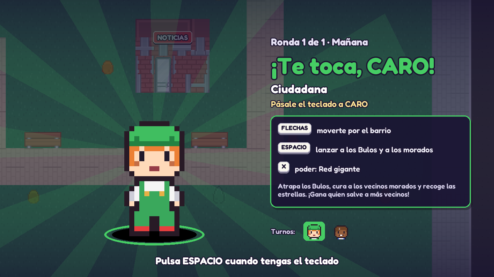
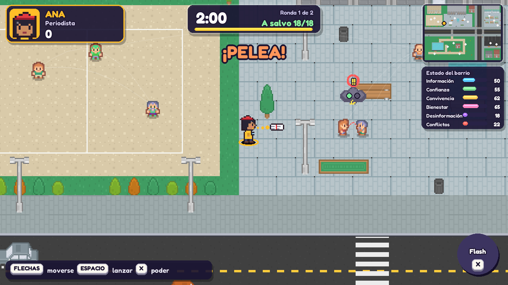
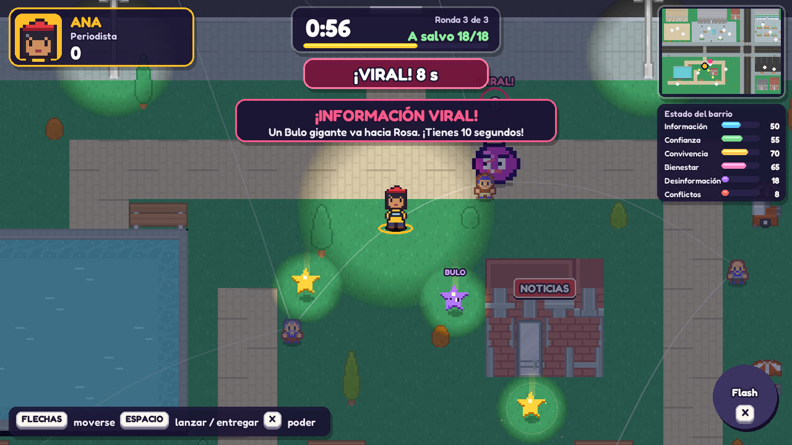
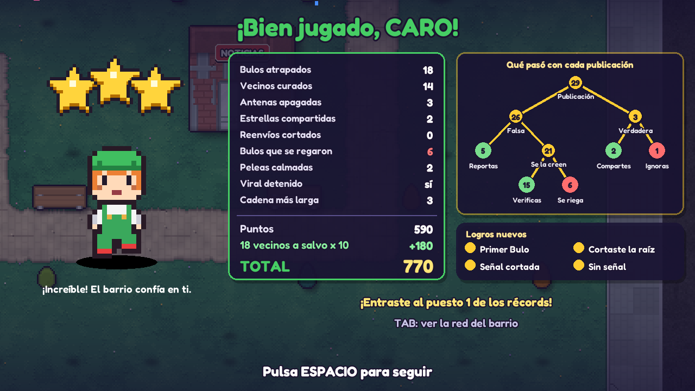
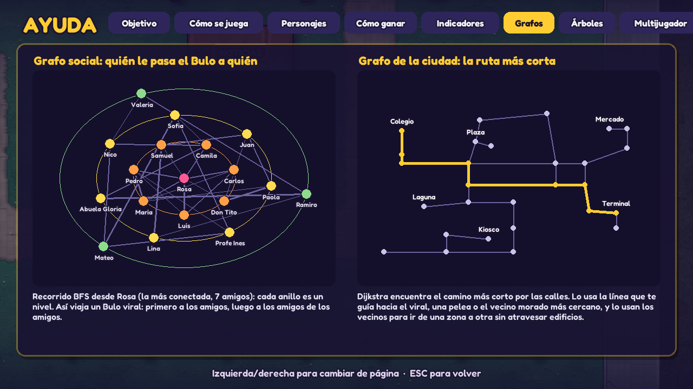

# Entrega final · Cazabulos (Alcalde Digital)

Cómo cumple el juego cada punto del enunciado, y las respuestas a las preguntas de la sustentación.


## 1. La idea

Caminas con tu personaje por un barrio de Ciudad Nova (un mapa de 64 x 46 tiles, unas 3 pantallas, con cámara que te sigue). Los **Bulos** (rumores falsos) salen de la antena del Bot y vuelan hacia los vecinos; si llegan, se les suben a la cabeza y se los pasan a sus amigos por los hilos de la red social. Tú los atrapas, curas a los vecinos, revisas las noticias (estrellas) antes de compartirlas, calmas peleas y apagas antenas. Gana quien salve a más vecinos.

El aprendizaje sale de las mecánicas, no de preguntas: **detenerse a mirar una noticia antes de compartirla**, que la información verificada protege, que cortar el origen de una cadena la detiene y que las peleas rompen la comunidad.

## 2. Requisitos del enunciado

| Punto del enunciado | Dónde está en el juego |
|---|---|
| 2 a 4 jugadores con roles distintos | Ana (Periodista), Beto (Influencer), Caro (Ciudadana), Dani (Candidato). Cada uno con una ventaja y un poder propios (`cazabulos/mundo.py`, `ROLES`). Ninguno es más fuerte: en simulaciones de 90 s con el mismo jugador automático los cuatro sacan puntajes parecidos. |
| Influencer con mayor impacto | Lo que Beto entrega les llega también a los amigos del vecino (BFS de un nivel). Si entrega un Bulo sin mirarlo, también se lo riega a ellos. |
| Candidato construye confianza | La protección de Dani dura el doble, su Discurso cura vecinos y, si alguien juega con Dani, Dani aparece en la elección con votos según los vecinos que salvó. |
| Árboles y grafos con función real | Ver la sección 3. |
| Propagación por el grafo social | Un vecino con Bulo se lo reenvía al amigo con quien tiene más confianza (peso de la arista), como una bolita que viaja por el hilo. El viral se riega por BFS (hasta 2 niveles y como máximo 6 vecinos, en el orden del recorrido). |
| Quién recibe, cuántos, qué tan rápido, si es verdad, qué consecuencias | El BFS da quién y en qué orden; el banner dice a cuántos les llegó; el nivel BFS da la velocidad (cada nivel tarda más); los indicadores y puntos muestran las consecuencias; las noticias reales también se propagan (Beto). |
| Componente aleatorio | Eventos: noticias falsas, Bulo viral, rumor sobre un candidato, discusión entre vecinos, noticia verdadera (lluvia de estrellas), campaña de convivencia y un vecino que reporta. Cambian en cada partida (semilla), pero dentro de una ronda son los mismos para todos los jugadores. |
| Habilidad y decisión con tiempo límite | El **Bulo viral**: aparece con 10 segundos en pantalla y hay que golpearlo 3 veces. Además cada noticia obliga a decidir: mirarla (quedarse quieto) o compartirla ya. |
| Estado de la ciudad | 6 indicadores en vivo: información verificada, confianza, convivencia, bienestar digital, desinformación y conflictos (`Mundo.indicadores`). |
| Puntuación individual y resultado general | Puntos por jugador + bono por vecinos a salvo + estrellas de reputación. La ciudad tiene sus indicadores y la elección. |
| Logros, recompensas y retroalimentación | 14 logros guardados (`cazabulos/guardado.py`), combos, textos flotantes, mensaje final según cómo jugaste y el árbol de decisiones del turno. |
| Elección del alcalde | `calcular_eleccion` en `cazabulos/partida.py`: la regla es clara para los niños: si la desinformación promedio de todos los turnos llega a 50 (la mitad del barrio se creyó los Bulos), gana Emilio Bot. Si no, gana el candidato honesto con más votos; esos votos salen de la confianza, la convivencia, el bienestar y los rumores frenados o creídos sobre cada uno. |
| Multijugador cliente-servidor con sockets | `cazabulos/red/`: servidor TCP con hilos y mensajes JSON. Sincroniza la sala, los jugadores y sus personajes, las rondas (semilla y duración), las posiciones y puntajes en vivo, los avisos, los resultados de cada ronda y los finales. |
| Interfaz gráfica | Todo en pygame: ciudad, personaje, publicaciones (estrellas y Bulos), opciones, estado, puntuación, indicadores y resultados. |
| Inclusividad | Ver la sección 5. |
| Sistema de ayuda | Pantalla AYUDA de 8 páginas: objetivo, controles, personajes, cómo ganar, indicadores, grafos, árboles y multijugador. Durante la partida hay pistas que explican cada cosa la primera vez que pasa. |
| Elementos motivadores | Música y efectos, animaciones, partículas, temblor de cámara, confeti, podio, logros, récords, combos y mensajes. |

## 3. Las estructuras de datos

### Grafo social (`cazabulos/estructuras/grafo.py`, `cazabulos/ciudad.py`)

- **Qué representa:** 18 vecinos (vértices) y 29 amistades (aristas no dirigidas con peso de confianza 1 a 3). Rosa es "la del grupo de chat" y tiene 7 amigos.
- **Para qué sirve:**
  - **Propagación:** el Bulo se reenvía por el hilo con más confianza.
  - **Viral:** se riega con **BFS** limitado a 2 niveles y con un filtro (los vecinos protegidos no lo reciben ni lo pasan).
  - **Objetivo de los Bulos:** buscan al vecino de mayor **grado**.
  - **Influencer:** el BFS de un nivel lleva la noticia a los amigos.
  - **Comunidades:** **DFS / componentes**.
- **Se ve al final de cada turno:** en la pantalla de resultados, la tecla TAB muestra la red del barrio: quién quedó con Bulo, quién protegido, las amistades rotas (rojo) y las nuevas (verde), y cuántas comunidades quedaron (DFS).
- **Cambia durante la partida:**
  - Si una pelea no se calma, la amistad se rompe (**eliminar arista**) y el Bulo ya no pasa por ahí.
  - Si se calma, la confianza sube (el peso aumenta).
  - La campaña de convivencia crea amistades nuevas (**agregar arista**).

### Grafo de la ciudad (`cazabulos/mapa.py` `NODOS`/`ARISTAS`, `cazabulos/ciudad.py`)

- **Qué representa:** 28 lugares y esquinas (Colegio, Plaza, Alcaldía, Mercado, Parque, Kiosco, Terminal…) unidos por tramos de calle con peso = distancia. Cada tramo se comprueba contra las colisiones del mapa: no se usa uno que atraviese un edificio.
- **Para qué sirve:**
  - **Dijkstra** da la ruta más corta para la línea guía del jugador hacia lo más urgente (el viral, una pelea o la antena). La ruta se ve en el piso y en el minimapa.
  - Los vecinos la usan para ir de una zona a otra.

### Árbol de mutaciones (`cazabulos/estructuras/arbol_mutaciones.py`)

1. **Problema:** saber de dónde salió cada copia de un rumor y poder cortar la cadena desde su origen.
2. **Por qué un árbol:** cada Bulo tiene exactamente un padre (el que lo originó) y puede tener muchos hijos. Es una jerarquía sin ciclos.
3. **Variante:** árbol general (n-ario) con lista de hijos y referencia al padre. Hay un bosque de raíces: cada antena o evento crea una raíz.
4. **Insertar y eliminar:**
   - Insertar: cuando un Bulo salta a otro vecino, el nuevo Bulo se inserta como hijo.
   - Eliminar: al atrapar un Bulo se elimina **todo su subárbol**. Por eso la raíz (con corona) tumba toda la cadena.
5. **Recorridos:** preorden para la animación de la cadena que cae; también postorden, por niveles, altura, tamaño y camino a la raíz.

### Árbol de decisiones de la noticia (`cazabulos/estructuras/arbol_decision.py`)

1. **Problema:** cada noticia pasa por decisiones (mirarla, compartirla sin mirar, dejarla) y cada camino tiene consecuencias distintas. Las reglas quedan en un solo lugar.
2. **Por qué un árbol:** son decisiones encadenadas que se abren en opciones y terminan en un resultado (hoja), como el ejemplo del enunciado.
3. **Variante:** árbol general con aristas etiquetadas; las hojas guardan el efecto (puntos e indicadores).
4. **Insertar y eliminar:** `insertar(padre, etiqueta, nodo)` y `eliminar(clave)` quita la rama completa.
5. **Recorridos:**
   - `recorrer(etiquetas)` baja desde la raíz siguiendo lo que hizo el jugador y cuenta las visitas.
   - Preorden para dibujarlo al final del turno con los números.
   - Por niveles y camino a una hoja.

### AVL (`cazabulos/estructuras/avl.py`)

La tabla de récords: inserción y eliminación balanceadas, recorrido en orden inverso para el top 10, y se elimina el menor cuando hay más de 200.

## 4. Arquitectura en línea

```
            SERVIDOR (cazabulos/red/servidor.py)
     sala · rondas · semillas · marcador · resultados
        /              |               \
   CLIENTE 1        CLIENTE 2        CLIENTE 3 ...
   (Ana)            (Beto)           (Caro)
```

- **Mensajes (JSON, uno por línea, TCP):**
  - Del cliente al servidor: `hola`, `elegir`, `empezar`, `estado`, `resultado`, `listo`.
  - Del servidor a los clientes: `sala`, `ronda`, `marcador` (6 veces por segundo), `aviso`, `fin_ronda`, `fin`.
- **Cómo se juega:** cada cliente simula su propio barrio con la semilla que le da el servidor, así nadie depende de la conexión de otro para jugar. El servidor junta los resultados de todos para la tabla y la elección.
- **Cómo se abre la sala:** el que crea la sala corre el servidor dentro del juego. También existe `python servidor.py` para un servidor dedicado.

## 5. Inclusividad (Opciones)

- **Subtítulos de sonidos:** los sonidos importantes (pitos de carros, alarmas, golpes, contagios) aparecen escritos junto a donde ocurren. Atiende a quien no oye bien o juega sin volumen (como en una feria ruidosa).
- **Alto contraste:** borde blanco grueso en Bulos y estrellas, controles siempre visibles y la marca "TÚ" sobre el jugador. Atiende a quien ve poco o se distrae.
- **Modo tranquilo:** Bulos más lentos y peleas más largas. Atiende a niños pequeños y a quien está aprendiendo.
- **Personalización:** se puede cambiar la piel (5 tonos) y el pelo (6 colores) de cada personaje para que cada niño se vea representado.
- **Control USB:** se puede jugar sin teclado (cruceta, A, B/X y Start). Las ayudas en pantalla se cambian solas a los botones del control. Atiende a niños que no manejan bien un teclado.
- **Regreso solo al inicio:** si nadie toca nada en 90 segundos, el juego vuelve a la pantalla de inicio. Así el siguiente niño de la fila de la feria siempre encuentra el juego listo.
- **Formas además de colores:** los Bulos son gotas con antenas y las noticias son estrellas. La estrella falsa tiene un ojito. Así se distinguen aunque alguien no vea bien los colores.

## 6. Respuestas para la sustentación

- **¿Por qué un árbol?** Porque los rumores tienen origen y copias (cada copia tiene un solo padre) y porque las decisiones sobre una noticia se abren en ramas con un resultado al final. Cortar un subárbol es exactamente "detener la cadena desde su origen".
- **¿Por qué un grafo?** Porque las amistades no son una jerarquía: forman una red con ciclos, y la propagación depende de quién está conectado con quién. La ciudad también es una red de calles donde hay que encontrar rutas cortas.
- **¿Cómo afectan al jugador?** Si un vecino muy conectado se contagia, el Bulo llega a muchos. El jugador aprende a proteger primero a los más conectados y a buscar la raíz con corona.
- **¿Qué pasa cuando cambian las relaciones?**
  - Una pelea no calmada borra la arista: esos dos vecinos ya no se pasan nada, ni Bulos ni noticias.
  - Una campaña de convivencia crea aristas nuevas.
  - El BFS y la propagación usan siempre el grafo actual.
- **¿Cómo se comunica la información entre jugadores?** Por el servidor:
  - Posiciones (los fantasmas), puntajes en vivo, avisos ("Beto terminó su turno").
  - Resultados de cada ronda y resultados finales.
- **¿Qué comportamiento se fomenta?**
  - Detenerse a mirar antes de compartir.
  - Llevar información verificada a la gente.
  - No dejar que una discusión rompa la comunidad.
  - Saber que lo que comparte alguien con muchos seguidores llega más lejos, para bien o para mal.

## 7. Pruebas

`python -m unittest discover -s tests` corre 42 pruebas.

- **Estructuras:** BFS por niveles y con filtro, componentes, Dijkstra, subárboles, recorridos, árbol de decisiones y AVL.
- **Juego:**
  - Misma semilla, mismo barrio.
  - Contagio por el grafo, raíz que tumba la cadena.
  - Noticias mirada y sin mirar.
  - Influencer, peleas que rompen hilos, viral por BFS.
- **Mapa:** colisiones con edificios, grafo de la ciudad caminable y carros siempre en su carril sin chocar.
- **Partida y red:** turnos y rondas, elección y servidor con dos clientes.
- **Control USB y feria:** botones que cambian según la pantalla, palanca con margen para que no tiemble, cruceta que mueve al jugador y regreso solo al inicio sin interrumpir un turno ni el modo en línea, y el rescate que vuelve al inicio si una pantalla falla.

## 8. Capturas

| | |
|---|---|
|  |  |
|  |  |
|  |  |
|  |  |
