# Entrega final: Corta la mentira

**Alcalde Digital · Estructura de Datos II.** La entrega final pide el producto completo: árboles, grafos, interfaz gráfica, componente aleatorio, componente inclusivo, sistema de ayuda, elementos motivadores, modo multijugador, comunicación cliente-servidor y funcionamiento estable. Esta página dice dónde está cada cosa y por qué se hizo así. Las entregas anteriores están en [ENTREGA_1.md](ENTREGA_1.md) (árboles) y [ENTREGA_2.md](ENTREGA_2.md) (grafos); describen la versión por turnos, que se reemplazó por esta.

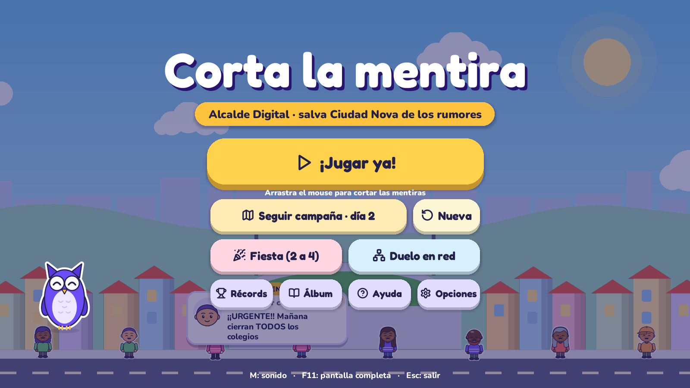

## Qué pide el enunciado y dónde está

| Sección del enunciado | Dónde está en el juego | Código |
|---|---|---|
| 3. Historia | Historia animada en cinco escenas al empezar la campaña, el **Diario Nova** cada mañana y la portada final de la elección | `corta/historia.py`, `corta/periodico.py` |
| 2. Objetivo: verificada, convivencia, confianza, bienestar; evitar desinformación y conflictos | Los 6 indicadores de Ciudad Nova (panel del mapa, resultado de cada barrio, elección) | `corta/campana.py`, `corta/contenido.py` |
| 3. Compartir, verificar, ignorar o reportar | La **alerta viral**: cuatro botones y un árbol de decisiones | `estructuras/arbol_decision.py`, `corta/nivel.py` |
| 4. Roles con habilidades distintas | Ana (Periodista), Beto (Influencer), Caro (Ciudadana), Dani (Candidato) | `corta/contenido.py` (`PODERES`), `Nivel._resolver` |
| 5. Árboles con función real | Árbol de decisiones, árbol del rumor y Archivo de hechos (AVL) | sección 2 de este documento |
| 6. Grafo de la ciudad y grafo social | Mapa de la campaña y red social de Civitas | sección 3 |
| 7. Propagación: quién, cuántos, qué tan rápido, si es verdad, consecuencias | Animación de la red después de cada alerta (BFS) | `Nivel._propagar`, `PantallaNivel._red` |
| 8. Eventos aleatorios | Los siete del enunciado, más viento, buses y focos nuevos de rumor cada noche | sección 9 |
| 9. Tiempo limitado para decidir | 10 segundos en la alerta viral (15 en modo tranquilo) | `ALERTA_SEG` en `corta/nivel.py` |
| 10. Indicadores que cambian | Suben y bajan en cada nivel y en cada noche | `Nivel.efectos_finales`, `Campana.noche` |
| 11. Puntuación individual y resultado de la ciudad | Puntos, estrellas, monedas, combos, **misión del día** y **18 logros**; resultado de la ciudad en la elección y en la portada final | `corta/nivel.py`, `corta/logros.py`, `corta/campana.py` |
| 12. Elección del alcalde según el comportamiento | Cuatro candidatos; vota cada barrio según cómo quedó | `Campana.votar` |
| 13. Multijugador cliente-servidor con sockets | Duelo en red (TCP, JSON por línea) y Fiesta por turnos | `red/sala.py`, `corta/duelo.py`, `corta/fiesta.py` |
| 14. Interfaz gráfica | Todo se juega con el mouse en Pygame | `corta/`, `ui/` |
| 15. Inclusividad | Símbolos grandes, alto contraste, modo tranquilo, menos movimiento, subtítulos y **personalización de personajes** | sección 10 |
| 16. Ayuda | Botón Ayuda con 9 secciones (también desde la pausa), la lechuza Civi y una **mano animada** que enseña a cortar | `corta/paneles.py` (`Ayuda`) |
| 17. Elementos motivadores | Combos, fiebre, estrellas, misiones, logros con aviso, tienda, álbum, jefe final, récords de la feria, confeti | sección 12 |

---

## 1. Cómo se juega

Las publicaciones salen disparadas desde el barrio. **Lo falso se corta** arrastrando el mouse; **lo verdadero se deja pasar** (las fuentes oficiales traen el chulito azul). Si una mentira cae, el barrio pierde confianza; si una noticia real llega, la gente se informa.

Una vez por nivel salta la **alerta viral**: el juego se congela y hay 10 segundos para decidir qué hacer con una publicación que se está regando. En la calle aparecen **vecinos peleando**: se corta la burbuja roja para que hagan las paces.

Cada barrio trae además una **misión del día** (calmar dos peleas, hacer un combo de 6, verificar en la alerta, cortar dos ORIGEN…), que se ve en el mapa antes de jugar y debajo del puntaje durante el nivel. Cumplirla da puntos y monedas. Así el mismo barrio se juega distinto cada día.

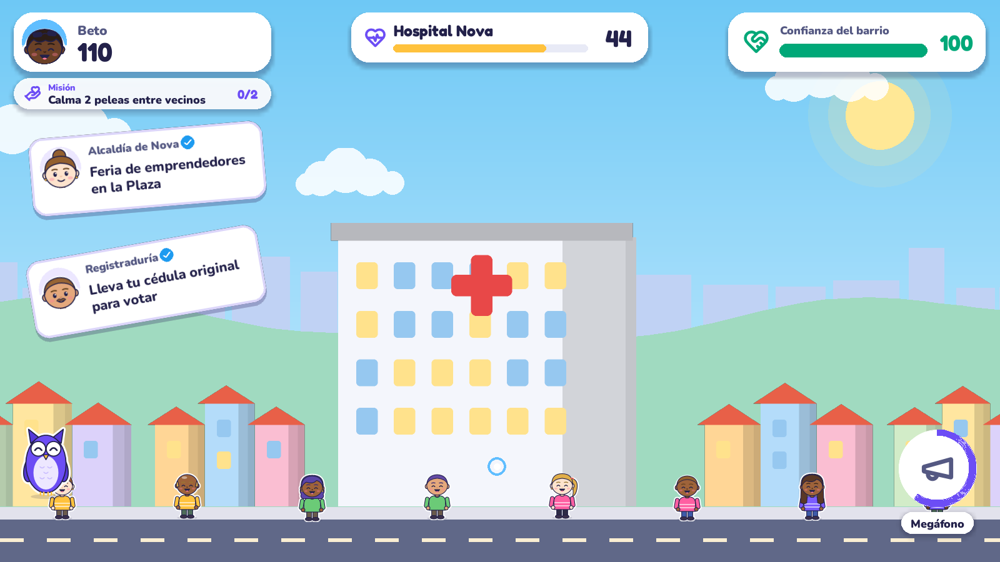

| Modo | Para qué |
|---|---|
| **¡Jugar ya!** | Un barrio de un minuto, con las primeras tarjetas marcadas («córtala» / «déjala pasar») y tabla de récords. Pensado para la feria. |
| **Campaña** | Liberar Ciudad Nova barrio por barrio en el mapa, comprar mejoras, llenar el álbum, vencer al Bot Supremo y llegar a la elección. Se guarda sola. |
| **Fiesta (2 a 4)** | Se turnan el mouse en el mismo computador. Gana quien sume más. |
| **Duelo en red** | Cada uno en su computador, al mismo tiempo, conectados por sockets. |

### 1.1 La historia

La campaña empieza con una historia animada de cinco escenas (se puede saltar con Esc):
1. Ciudad Nova va a elegir alcalde entre cuatro candidatos.
2. Todos se informan en Civitas, la red social.
3. El Bot Supremo la llena de mentiras para que gane Emilio.
4. Los barrios enferman.
5. El jugador y Civi salen a salvarla.

Cada mañana el **Diario Nova** cuenta lo más importante del día anterior («Ana frenó un rumor viral», «Rumor viral llegó a 14 vecinos»). Al final, la **portada de la elección** dice quién ganó y resume lo que hizo el jugador en toda la campaña, con una lección de Civi que cambia según cómo jugó.

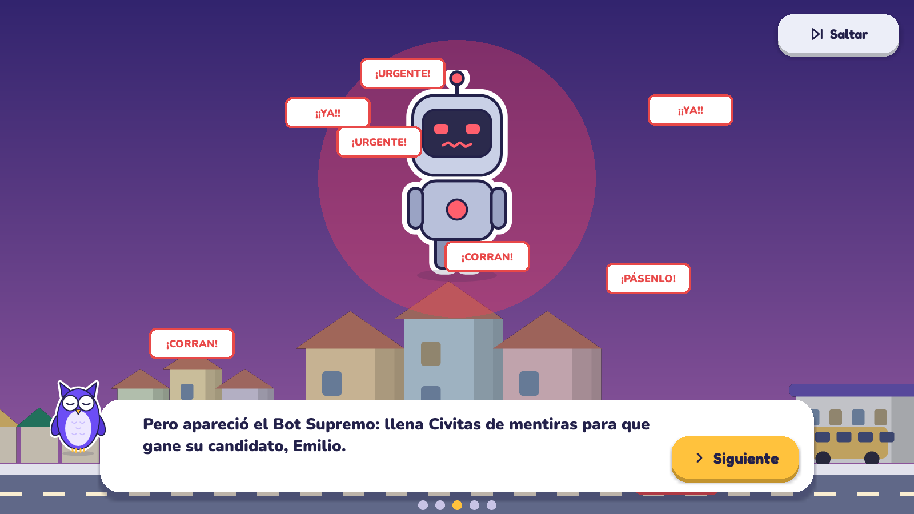
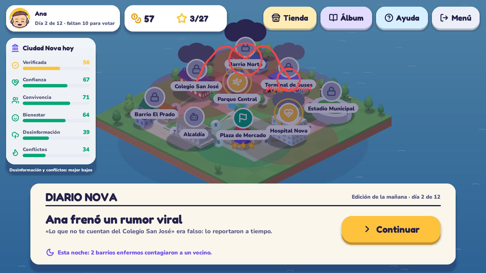
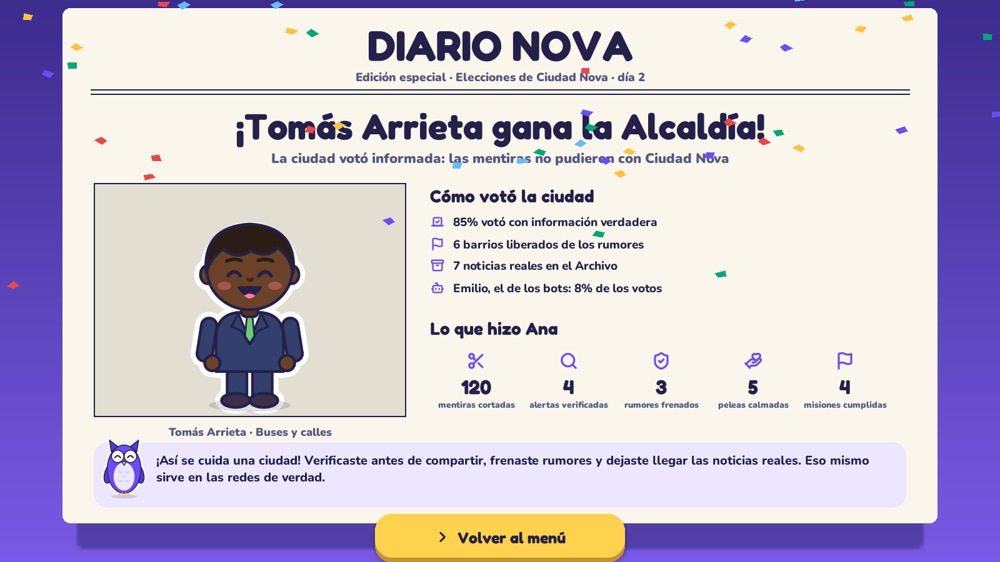

### 1.2 El contenido

61 publicaciones falsas y 41 verdaderas, cada una con su barrio. Las falsas se reparten en tres niveles de dificultad:
1. **Fáciles:** cadenas y audios, con las señales visibles.
2. **Medias:** imitan una fuente oficial sin chulito.
3. **Difíciles:** cuentas bot, fotos viejas y videos recortados, sin señales visibles.

Muchas son de la vida de un niño: el colegio, el recreo, el parque, las mascotas, el fútbol y los videojuegos («Comparte esto y te regalan un videojuego»). Hay 12 señales de mentira para descubrir en el álbum.

---

## 2. Árboles

El juego usa tres árboles, cada uno para un problema distinto.

### 2.1 Árbol de decisiones de la alerta viral (`estructuras/arbol_decision.py`)

**¿Qué problema resuelve?** Ante una publicación viral el jugador tiene cuatro opciones, y la consecuencia depende de lo que escoja y de si la publicación era verdadera. Verificar abre un segundo nivel de decisión: ya sabiendo la verdad, se decide si compartir o reportar. Ese recorrido de preguntas y respuestas hasta una consecuencia es exactamente un árbol (es el ejemplo del enunciado).

**¿Por qué un árbol?** Cada decisión depende solo de la anterior: no hay ciclos y cada camino termina en una consecuencia. Con un árbol el juego no necesita una cadena de `if`: los botones que se muestran son los hijos del nodo actual, y la consecuencia está guardada en la hoja a la que se llega.

**Variante.** Árbol n-ario con raíz y puntero al padre. Hay tres clases de nodo:

| Nodo | Quién lo resuelve | Ejemplo |
|---|---|---|
| Acción | El jugador (un botón por hijo) | *Publicación viral*: Verificar, Compartir, Reportar, Ignorar |
| Pregunta | El juego, mirando la publicación. Si `revela` está activo, el jugador ve la respuesta (eso es verificar) | *¿Es verdadera?* |
| Hoja | Nadie: es la consecuencia (puntos, cambios en los indicadores y si se propaga por la red) | *Verificar → Es falsa → Reportar*: +70 |

El árbol completo tiene 21 nodos, 10 hojas y altura 4. Se dibuja en **Ayuda › La alerta viral**:

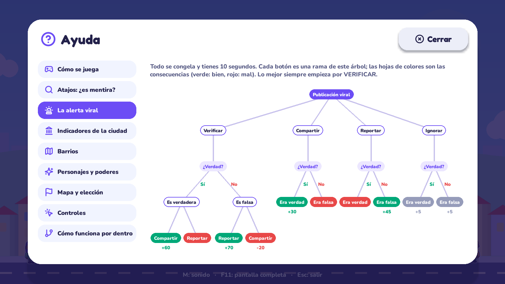

**Inserción y eliminación.** `insertar(clave_padre, nodo)` cuelga un nodo nuevo (por ejemplo, una opción «Preguntar a un adulto») y lo registra en un índice por clave para encontrarlo en O(1). Una hoja no puede tener hijos. `eliminar(clave)` quita el nodo **con todo su subárbol**, porque si una opción deja de existir, tampoco existe lo que venía después; recorre el subárbol en postorden para borrarlo del índice.

**Recorridos.**
- *Jugando*: desde la raíz, `elegir` baja por el botón pulsado y `avanzar` baja sola por las preguntas silenciosas hasta llegar a algo que el jugador deba ver.
- *Camino a la raíz*: al terminar, `camino(hoja)` sube por los punteros al padre. El juego le muestra al jugador **su camino en el árbol** (*Publicación viral › Verificar › ¿Es verdadera? › Es falsa › Reportar*).
- *Preorden* (con pila) para el índice, *postorden* para eliminar y *por niveles* (BFS con cola) para la altura y el dibujo de la ayuda.

**Cómo cambia según el rol.** La misma hoja vale distinto para cada personaje: la periodista gana +15 si verificó, lo que comparte el influencer pesa el doble, la ciudadana suma convivencia al reportar y el candidato gana o pierde más confianza.

### 2.2 Árbol del rumor (`estructuras/arbol_mutaciones.py`)

Un rumor marcado como **ORIGEN** es la raíz. Si llega arriba sin cortar, lo reenvían los dos seguidores de su autor con más confianza (aristas de salida del grafo social): cada reenvío es un **hijo** en el árbol. Cortar el origen **poda el subárbol** y caen todas las copias de una vez. Es un árbol n-ario con puntero al padre; `podar` recorre en postorden.

### 2.3 Archivo de hechos (`estructuras/archivo_avl.py`)

Cada noticia verdadera que llega a la gente (o que se comparte en la alerta) se guarda en un **AVL**. El álbum la muestra en orden alfabético con un recorrido en **inorden**. La campaña se guarda en **preorden** y se reconstruye con la misma forma, sin rotar. La justificación completa está en [ENTREGA_1.md](ENTREGA_1.md).

---

## 3. Grafos

Los dos usan la misma clase `Grafo` (`estructuras/grafo.py`): lista de adyacencia con diccionarios, más el índice inverso para los predecesores.

| | Mapa de Ciudad Nova | Red social de Civitas |
|---|---|---|
| Variante | No dirigido y ponderado | Dirigido y ponderado |
| Vértices | 9 barrios | 20 vecinos y los jugadores |
| Arista | Calle | `u → v`: v sigue a u (lo que u publica le llega a v) |
| Peso | Minutos de la calle | Confianza de v en u (0 a 1) |
| Archivo | `modelo/mapa.py` | `modelo/red_social.py` |

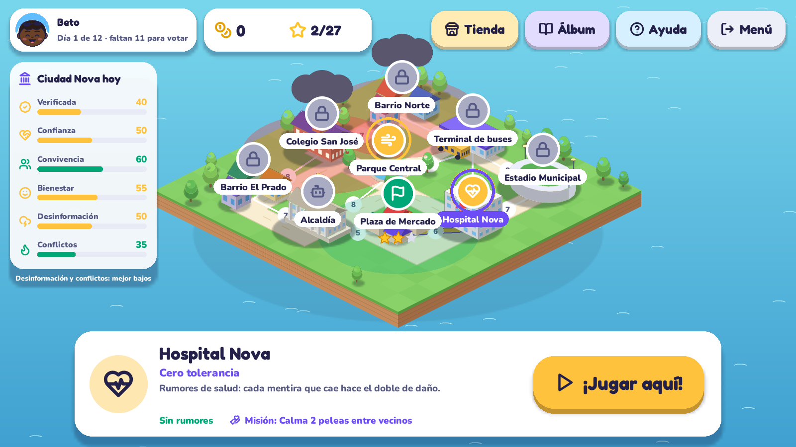

**Para qué se usa el mapa.**
- **Por dónde se avanza:** solo se juega en barrios vecinos de uno liberado (adyacencia).
- **Contagio de noche:** cada barrio muy enfermo contagia a un vecino no liberado, que es un paso de BFS desde los focos. Los barrios liberados hacen de muro.
- **Ruta en el mapa:** se marca la ruta de menos minutos desde la Plaza con **Dijkstra**.
- **Acceso al jefe:** la Alcaldía, vecina de la Plaza, pide liberar 4 barrios antes de enfrentar al jefe.

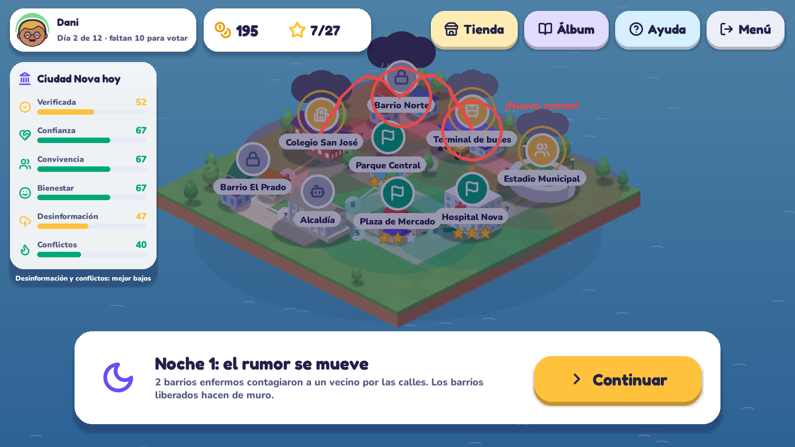

**Para qué se usa la red social.**
- **Quién publica:** de ella salen los autores de las publicaciones (vecinos del barrio donde se juega).
- **Reenvíos del ORIGEN:** cuando un ORIGEN llega arriba, lo reenvían sus seguidores (aristas de salida ordenadas por peso).
- **Cuánto llega lo que comparte cada jugador:** el jugador es un vértice más. Sus seguidores dependen del rol (ciudadana 4, periodista 6, candidato 8, influencer 12), así que lo que comparte el influencer llega más lejos: es su habilidad, y sale del grafo.
- **Mi red (álbum):** la página «Mi red» dibuja el grafo desde el jugador con un BFS. Cada color es un salto: cuántos lo siguen, a cuántos llega en 2 y en 3 saltos, a cuántos sigue (grado de entrada) y quiénes son los superpropagadores (centralidad de grado).
- **Cómo se genera la red:** las amistades se apoyan en el mapa (es más probable entre vecinos de la misma zona o de zonas con calle). Después se unen las componentes sueltas, que se encuentran con **DFS**.

---

## 4. Propagación de información (sección 7)

Después de cada alerta viral se ve la red social con la publicación avanzando **salto por salto**. Es el árbol BFS que devuelve `Grafo.bfs` con un filtro: cada arista se cruza con una probabilidad que sale de la **confianza** (peso) y de qué tan **crédulo** es quien la recibe. La mentira se cruza más fácil que la verdad.

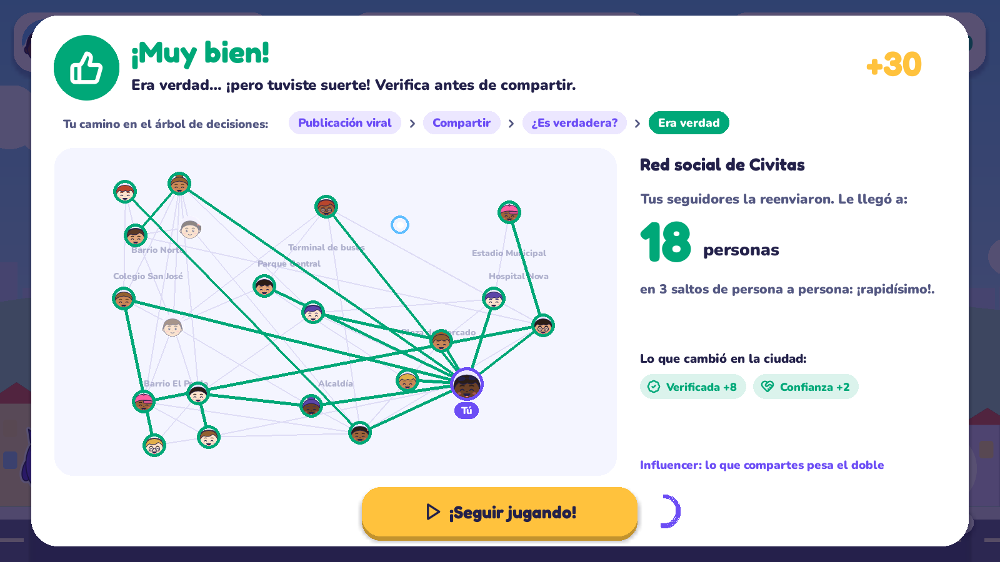

| Lo que pide el enunciado | Cómo lo responde el juego |
|---|---|
| Qué ciudadanos la reciben | Las caras que se iluminan y las líneas de quién se la pasó a quién (`padre` del BFS) |
| Cuántas personas | El número grande («le llegó a 18 personas») |
| Qué tan rápido | Los saltos (niveles del BFS): «en 3 saltos de persona a persona: ¡rapidísimo!» |
| Si es verdadera o falsa | Verde si era verdad, rojo si era mentira, gris punteado si la frenaste |
| Qué consecuencias genera | Una mentira que se riega quita confianza al barrio y sube la desinformación; una verdad compartida suma información verificada y llena el Archivo |

Si el jugador **reporta** una mentira, el juego calcula el mismo BFS desde el autor y muestra **a cuántos les habría llegado**, para que se vea lo que se evitó. Si la **ignora**, la comparten otros desde el autor con menos fuerza.

---

## 5. Habilidad y tiempo limitado (sección 9)

- **Alerta viral:** 10 segundos con reloj, contador de «veces compartida» que sube y tictac en los últimos segundos. Si se acaba el tiempo, cuenta como ignorarla.
- **Verificar:** muestra el sello VERDADERA o FALSA y las pistas que delatan la mentira (sin chulito, cifra imposible, cuenta bot…). Después hay que escoger entre compartir y reportar.
- **El resto del nivel también pide habilidad:** cortar a tiempo sin tocar las verdades, cortar el ORIGEN antes de que se reenvíe, calmar peleas, decidir cuándo usar el poder y qué barrio salvar en el mapa.

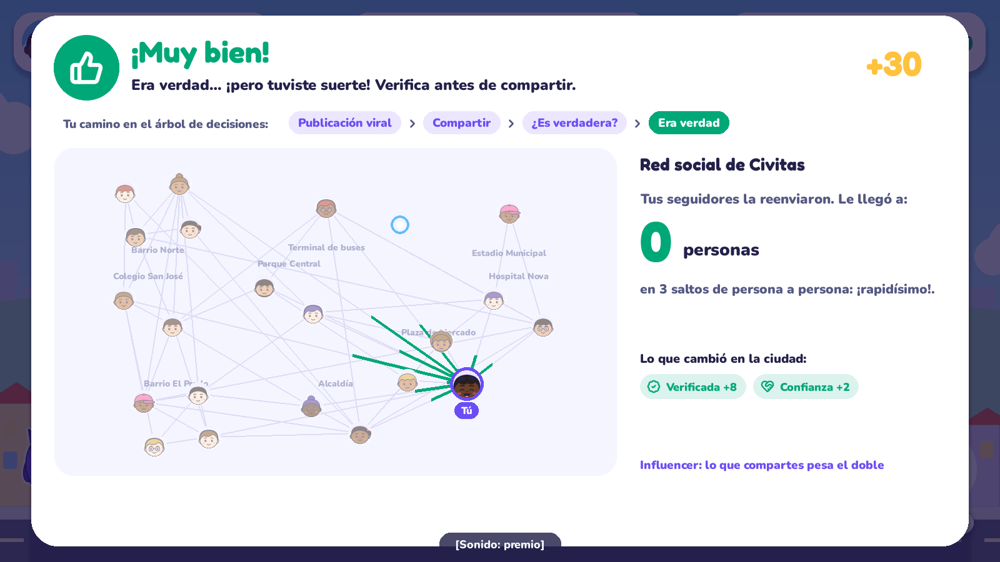

---

## 6. Estado de la ciudad y puntuación (secciones 10 y 11)

| Indicador | Sube con | Baja con |
|---|---|---|
| Información verificada | Noticias reales que llegan, verificar, compartir verdades | Cortar una verdad, reportar una verdad |
| Confianza ciudadana | Salvar barrios con buena confianza, liberar barrios | Perder un barrio, compartir mentiras |
| Convivencia | Calmar peleas, campañas de convivencia, reportar | Peleas sin calmar |
| Bienestar digital | Estrellas, campañas de convivencia | Virales que caen, perder |
| Desinformación (mejor baja) | Mentiras que caen o se comparten, contagios de noche | Cortar y reportar mentiras |
| Conflictos (mejor bajo) | Peleas, ataques sin pruebas que caen, contagios | Calmar peleas |

Cada nivel calcula cuánto movió cada indicador (`Nivel.efectos_finales`, entre −15 y +15) y la campaña lo aplica (`Campana.mover_indicadores`, entre 0 y 100). La pantalla del resultado lo muestra en pastillas verdes o rojas:

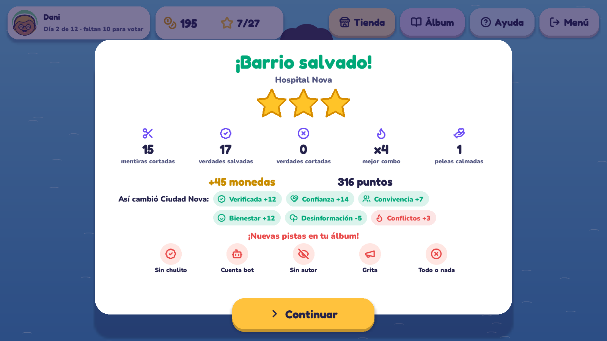

**Puntuación individual:** puntos, combos, fiebre (x2), estrellas (1 a 3), monedas para la tienda, pistas y hechos del álbum, y el puesto en los récords.

---

## 7. Elección del alcalde (sección 12)

Cuatro candidatos: tres con propuestas (Valentina Ríos, Tomás Arrieta y Luz Marina) y **Emilio**, que hace campaña con cadenas y bots. Si juegas con Dani, el Candidato, **tú** reemplazas a uno de los tres.

Cada barrio vota. Qué tan informado vota depende de si lo liberaste (y con cuántas estrellas), de cuánto rumor le quedó y de los seis indicadores. Los informados votan sobre todo por el candidato que más conocen en su barrio; de los desinformados, la mitad le cree a la campaña de bots. Si la ciudad quedó desinformada, **gana Emilio**: la consecuencia de las decisiones se ve en el resultado.

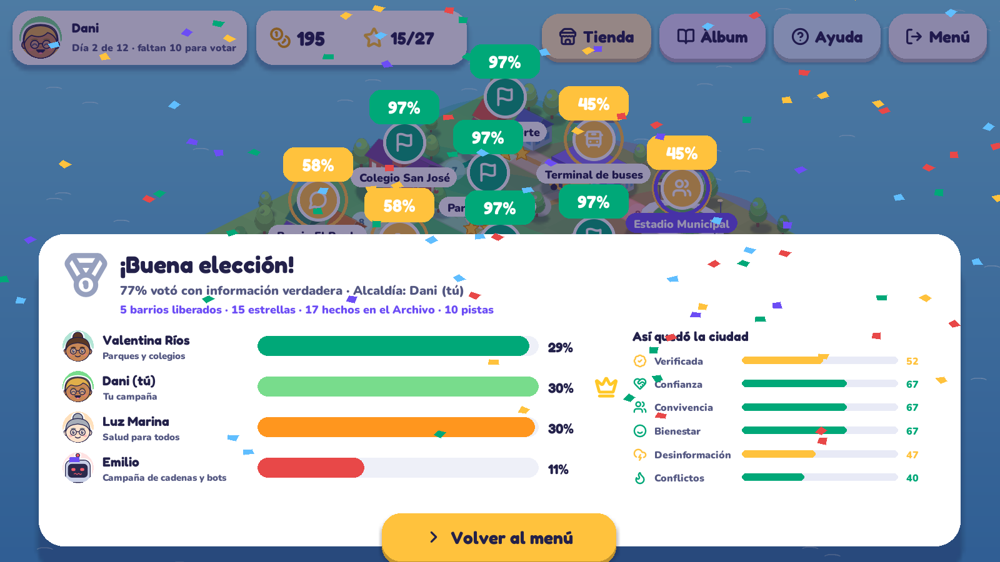

---

## 8. Multijugador cliente-servidor (sección 13)

**Duelo en red** (`red/sala.py`): un servidor TCP con un hilo por cliente y mensajes JSON, uno por línea (`red/protocolo.py`). El anfitrión corre el servidor en un hilo y se conecta como un cliente más; también hay un servidor sin ventana (`python servidor.py`).

| Lo que debe mantener el servidor | Cómo |
|---|---|
| Estado de la partida | Sala o jugando, barrio escogido, quién es el anfitrión (si se va, pasa al siguiente) |
| Jugadores | Nombre, personaje, look y color de cada conexión |
| Publicaciones | El servidor reparte una **semilla**: todos ven las mismas publicaciones en el mismo orden |
| Relaciones | Con esa semilla cada cliente construye la misma red social y el mismo mapa |
| Eventos | Ataques (combo de 5 → un rumor extra a cada rival), avisos de desconexión e historial de la sala |
| Puntuaciones | Cada cliente manda sus puntos y su confianza cada medio segundo; el servidor reparte el marcador ordenado |
| Información compartida | Lo que un jugador **comparte en la alerta viral** el servidor se lo pasa a los rivales: si era verdad deben dejarla pasar, y si era mentira, cortarla |
| Turnos | En el duelo todos juegan a la vez. Los turnos están en el modo **Fiesta**, donde 2 a 4 jugadores se pasan el mouse |

---

## 9. Componente aleatorio (sección 8)

| Evento del enunciado | En el juego |
|---|---|
| Aparece una noticia falsa | Las publicaciones falsas, con tres niveles de dificultad |
| Una publicación se vuelve viral | La alerta viral y las tarjetas ¡VIRAL! (tres cortes para romperlas) |
| Aparece un rumor sobre un candidato | Las mentiras con la señal «ataque sin pruebas»; si caen, suben los conflictos |
| Se produce una discusión entre ciudadanos | Dos vecinos peleando en el andén |
| Se publica una noticia verdadera | Las publicaciones con chulito azul |
| Aparece una campaña de convivencia digital | Un objeto especial que sube convivencia, bienestar y confianza |
| Un ciudadano reporta contenido | Un vecino reporta y tumba una mentira por su cuenta |

También son aleatorios el viento, los buses, los ORIGEN, los objetos especiales, el jefe final y los focos nuevos de rumor cada noche. Lo que no es azar: cortar, decidir, a qué barrio ir y cuándo usar el poder. La misma semilla repite la partida (`python main.py 42`).

---

## 10. Inclusividad (sección 15)

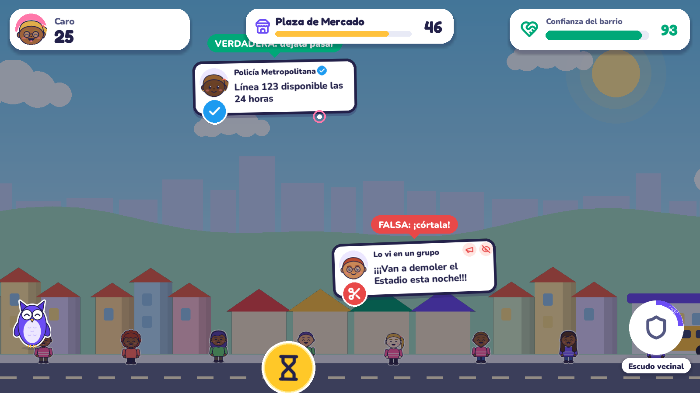

| Opción | Qué dificultad atiende |
|---|---|
| **Símbolos grandes** | Niños que todavía no leen: cada tarjeta muestra unas tijeras rojas (córtala) o un chulito azul (déjala pasar) |
| **Alto contraste** | Baja visión: el fondo se oscurece y las tarjetas tienen borde negro grueso |
| **Modo tranquilo** | Niños pequeños o quien lee despacio: todo va más lento y la alerta da 15 segundos |
| **Menos movimiento** | Sensibilidad al movimiento: sin temblores de pantalla ni confeti |
| **Subtítulos de sonido** | Personas sordas o con poca audición: los sonidos importantes salen en texto |
| Formas además de color | Daltonismo: lo bueno y lo malo nunca se distinguen solo por el color (íconos, sellos, signos + y −) |
| **Personalizar personaje** | Que cada niño se reconozca en el juego: piel (6 tonos), peinado (9), color de pelo, ropa y accesorio. Se guarda y se usa en todos los modos |

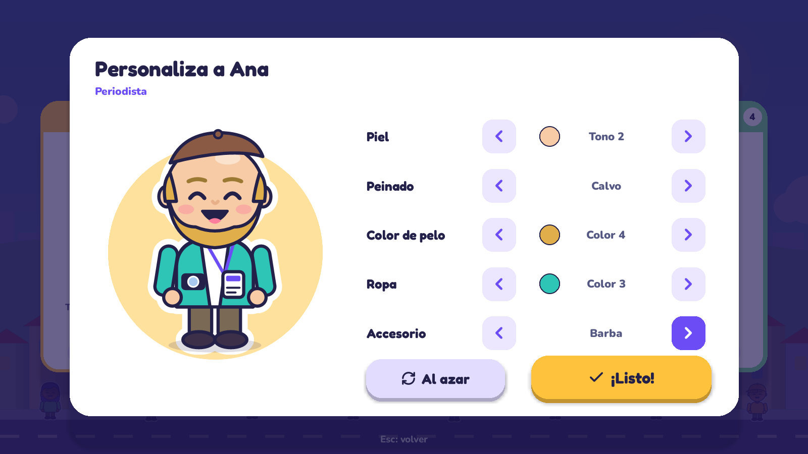

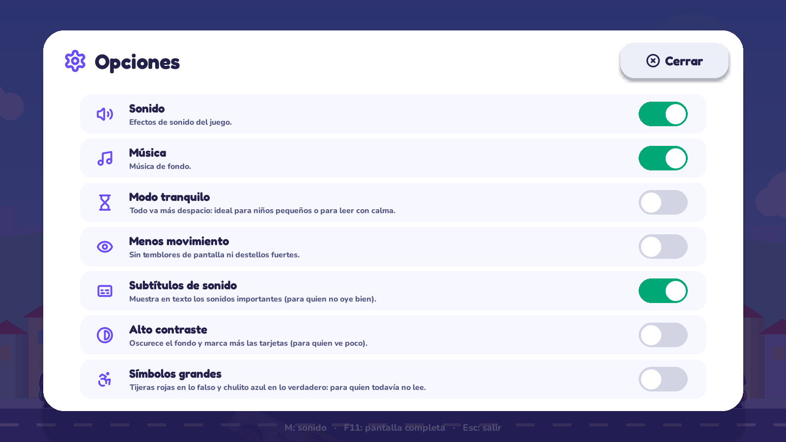

---

## 11. Sistema de ayuda (sección 16)

El botón **Ayuda** (en el menú, en el mapa y en la pausa de cada nivel) tiene nueve secciones: cómo se juega, atajos para reconocer mentiras, la alerta viral (con el árbol dibujado), los indicadores de la ciudad, los barrios, los personajes y sus poderes, el mapa y la elección, los controles y cómo funciona por dentro. Durante el juego, la lechuza **Civi** explica cada cosa la primera vez que pasa: la regla del barrio, el ORIGEN, las peleas, el apagón del jefe y, en la alerta, «¿No sabes si es verdad? ¡Verifica primero!». En los niveles con guía, una **mano animada** muestra cómo arrastrar sobre la primera mentira marcada, para quien todavía no lee las instrucciones.

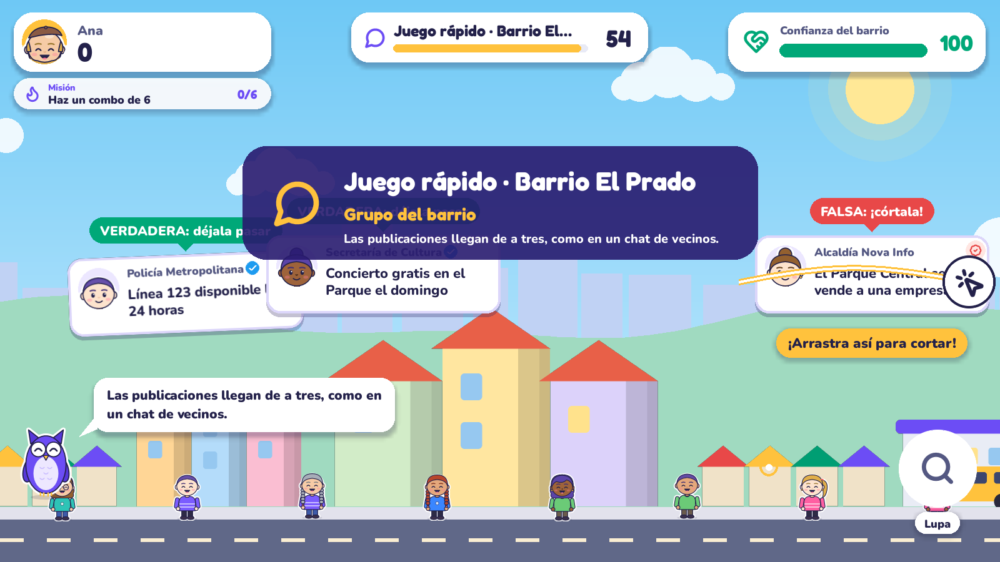

---

## 12. Elementos motivadores (sección 17)

Cada uno tiene una función en el juego:
- **18 logros** (Primer tajo, Detective, Pacificador, Héroe de Nova, Ciudad informada…): se ganan en cualquier modo. Al ganar uno aparece un aviso con sonido, y el álbum muestra cuánto falta para cada uno. Varios premian justo lo que el juego quiere enseñar: verificar, frenar rumores, compartir noticias reales y calmar peleas.
- **Misión del día:** un objetivo distinto en cada barrio, con premio.
- **Combos y fiebre:** premian cortar seguido y sin equivocarse.
- **Estrellas, monedas y tienda de mejoras:** dan una razón para volver a jugar un barrio.
- **Álbum:** pistas y hechos para coleccionar; es lo que el jugador aprendió.
- **Jefe final con tres fases:** cierra la campaña.
- **Récords de la feria:** cada niño quiere entrar a la tabla.
- **Sonidos, música, partículas, temblor y confeti al ganar:** muestran el efecto de cada acción.
- **Personajes que reaccionan:** los vecinos del andén se alegran o se enojan según la confianza del barrio.

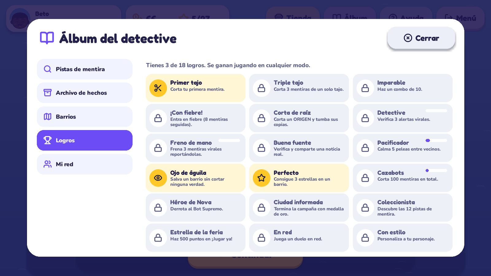
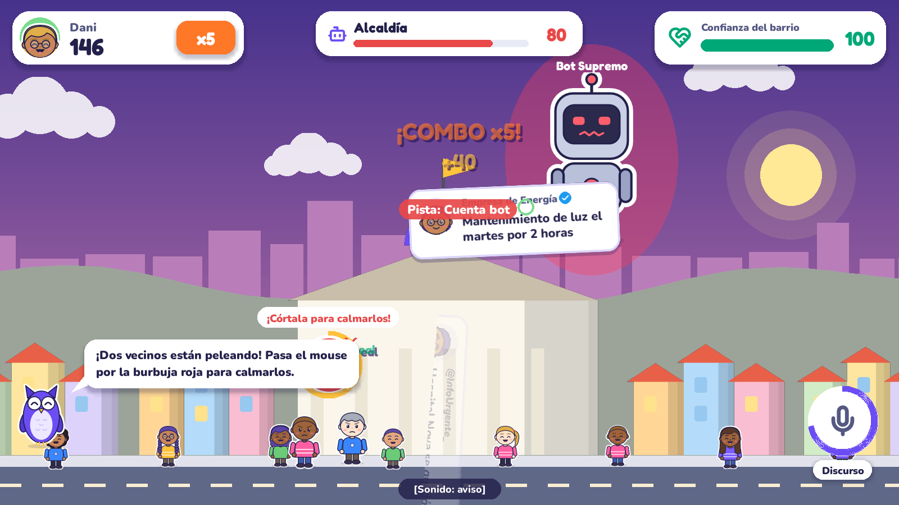

---

## 13. Pensado para la VI Feria Gamer

- **Entrar a jugar rápido:** «¡Jugar ya!» es el primer botón. Se escoge personaje y en segundos se está jugando; las primeras tarjetas vienen marcadas para aprender sin leer instrucciones.
- **Botones grandes:** con ícono y número; en la alerta también se puede usar el teclado (1 a 4).
- **Pocos sustos para quien atiende el stand:** `Esc` en el menú pregunta antes de cerrar y «Nueva campaña» pregunta antes de borrar. Si nadie pulsa «Seguir» después de la alerta, el juego continúa solo.
- **Tabla de récords** al final de cada partida rápida.

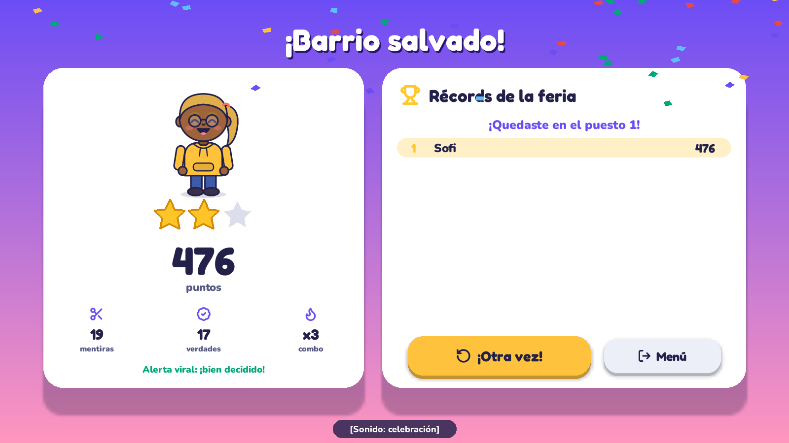

---

## 14. Funcionamiento estable

`python -m unittest discover -s tests -v` corre **65 pruebas**:
- **Estructuras:** árboles, AVL, grafo y mapa.
- **Partidas:** cada barrio terminando, la misma semilla dando el mismo nivel y el jefe derrotable.
- **Árbol de decisiones:** su forma, cómo se recorre, inserción y eliminación.
- **Alerta viral:** congela la ciudad, verificar enseña las pistas y se acaba sola si se agota el tiempo.
- **Propagación:** solo viaja por aristas de la red y cada salto es un nivel del BFS.
- **Calle:** discusiones que se calman o que suben los conflictos.
- **Campaña:** indicadores acotados y guardados, la elección cambiando según lo que se hizo, guardar y cargar.
- **Logros, misiones, Diario Nova, estadísticas de la campaña, lección final y personajes guardados.**
- **Récords** y **red:** un duelo real con un servidor y dos clientes, y lo compartido llegando a los rivales.

Además se probó jugando de verdad, sin ventana y con capturas: una campaña completa (historia, cinco barrios, jefe, elección y portada), un duelo con dos clientes y más de 50.000 cuadros de clics y teclas al azar en todas las pantallas, sin errores.

---

## 15. Para la sustentación

**¿Por qué utilizaron un árbol?** Para tres problemas jerárquicos: las decisiones de la alerta viral (cada opción abre otras y termina en una consecuencia), los reenvíos de un rumor (cada copia tiene un único padre; cortar el origen poda todas) y el Archivo de hechos (búsqueda e inserción en O(log n) y lectura en orden).

**¿Por qué utilizaron un grafo?** Porque las calles y las relaciones entre personas no son jerarquías: hay ciclos, cada nodo tiene varios vecinos y las relaciones tienen peso (minutos y confianza).

**¿Qué problema resuelve cada estructura?** Ver las secciones 2 y 3.

**¿Cómo afectan las decisiones del jugador?** La decisión escoge la rama del árbol, y la hoja dice si la publicación se propaga y desde quién. El grafo decide a cuántos llega y por dónde. Los indicadores y la elección recogen el resultado.

**¿Qué pasa cuando cambian la información o las relaciones?**
- **Información:** si la publicación es falsa, se propaga con más probabilidad y daña la ciudad; si es verdadera, suma información verificada.
- **Relaciones:** si cambian los seguidores o la confianza (los pesos), cambia quién la recibe. Un influencer, con más aristas de salida, llega más lejos. Un barrio liberado corta el contagio por el mapa.

**¿Cómo se comunica la información entre los jugadores?** Por el servidor del duelo: la semilla común, el marcador, los ataques y lo que cada uno comparte en la alerta viral (sección 8).

**¿Qué comportamiento responsable busca fomentar?** **Verificar antes de compartir**, reconocer las señales de una mentira, no reportar lo que es verdad, frenar las cadenas desde el origen y calmar las peleas en lugar de echarles leña. Nunca se pregunta «¿qué es una noticia falsa?»: se aprende cortando, decidiendo y viendo qué pasa en la red.

---

## Recursos de terceros

Fuentes Fredoka y Nunito (licencia OFL, en `assets/fuentes/`) e íconos Lucide (licencia ISC, en `assets/iconos/`). Los sonidos se generan con `tools/generar_audio.py`, sin grabaciones externas.
